# Meeting Guide: Abdallah + Karim Decision Meeting

**Goal of the meeting:** leave with a **locked tech stack**, a **clear ownership split**, a **budget**, and a **6-week plan** for the prototype the company will evaluate.

**Duration:** about 3 hours (with a break). Decide things in this order: later decisions depend on earlier ones.

```mermaid
flowchart LR
    A["1. Scope and success criteria"] --> B["2. Cloud strategy and ownership"]
    B --> C["3. AI stack: LLM, embeddings, parsing"]
    C --> D["4. Data stack: vector DB, Postgres"]
    D --> E["5. Ranking method and evaluation"]
    E --> F["6. App stack: frontend, backend, hosting, auth"]
    F --> G["7. Security, compliance, DevOps"]
    G --> H["8. Budget, roadmap, next actions"]
```

---

## Agenda

| # | Time | Topic | Read before | Must decide |
|---|---|---|---|---|
| 1 | 15 min | Scope, competitors & pitch edge | [01-vision-and-scope.md](01-vision-and-scope.md), [08-competitor-analysis.md](08-competitor-analysis.md) | What the company sees; why we beat Atlas/TestGorilla/Manatal/Zoho/Elevatus; demo date |
| 2 | 20 min | Cloud strategy & ownership | [ADR-002](decisions/002-cloud-strategy.md), [ADR-001](decisions/001-team-and-ownership.md) | AWS/Azure split, regions, who owns what |
| 3 | 30 min | AI stack | [ADR-005](decisions/005-ai-service-runtime-and-hosting.md), [ADR-006](decisions/006-llm-provider-and-model.md), [ADR-007](decisions/007-embedding-model.md), [ADR-008](decisions/008-cv-parsing.md) | LLM model tier, embedding model + dimensions, parsing approach |
| 4 | 20 min | Data stack | [ADR-009](decisions/009-vector-database.md), [ADR-010](decisions/010-primary-database.md) | Pinecone vs alternatives; Postgres hosting |
| ☕ | 10 min | Break | | |
| 5 | 35 min | Ranking & evaluation (**most important**) | [ADR-011](decisions/011-ranking-and-scoring-method.md), [ADR-018](decisions/018-evaluation-strategy.md) | Scoring formula, default weights, how we prove quality, dataset source |
| 6 | 25 min | App stack & connectors | [ADR-003](decisions/003-frontend-framework.md), [ADR-004](decisions/004-backend-framework.md), [ADR-012](decisions/012-aws-compute-and-hosting.md), [ADR-013](decisions/013-authentication.md), [ADR-014](decisions/014-ingestion-channels-and-queue.md), [ADR-020](decisions/020-external-connectors-and-linkedin.md) | Frameworks, hosting, auth, CV channels & LinkedIn Easy Apply plan |
| 7 | 15 min | Security, compliance, DevOps | [ADR-015](decisions/015-cross-cloud-security-and-networking.md), [ADR-016](decisions/016-iac-cicd-and-repo.md), [ADR-017](decisions/017-observability-and-llm-ops.md), [ADR-019](decisions/019-privacy-compliance-and-fairness.md) | Cross-cloud auth, Terraform layout, tracing, privacy rules |
| 8 | 15 min | Budget, roadmap, future scale | [03-cost-model.md](03-cost-model.md), [04-roadmap.md](04-roadmap.md), [05-risks.md](05-risks.md), [07-future-evolution.md](07-future-evolution.md) | Monthly budget cap, credits to apply for, week-1 tasks, Phase 2 readiness |

---

## Questions we must answer in this meeting

### Business & scope
- [ ] **Demo date?** The roadmap assumes 6 weeks. Is that realistic?
- [ ] **Demo format?** Hosted URL the company can try alone, or a guided live demo?
- [ ] **What does "success" look like to the company?** For example: "Top 10 matches HR picks", speed, cost, UI polish?
- [ ] **Demo data:** Will the company give anonymised real CVs and JDs, or do we build our own dataset?
- [ ] **CV languages:** English only, or **Arabic + English**? This affects ADR-008, ADR-011 and ADR-018.
- [ ] **Expected scale in the demo:** 500? 2,000? 10,000 CVs?

### Money
- [ ] **Monthly budget cap** we personally accept until funding: \$50? \$100?
- [ ] **Who pays, and on which card/account?** Set up AWS Budgets and Azure Cost Alerts on day 1.
- [ ] **Startup credits:** who applies to AWS Activate, Microsoft for Startups and the Pinecone startup program?

### Technical
- [ ] Accept the **stateless AI service boundary** (AI service never touches Postgres)?
- [ ] LLM tier: **mini** (cheap, good) or **full** model (better, about 5× the price)?
- [ ] Pinecone free tier, or start directly on **pgvector** (one less vendor)?
- [ ] Which **CV channels** are in the demo: apply link, bulk ZIP, email forwarding, Google Forms?
- [ ] Do we need **Arabic** keyword search in the prototype?
- [ ] **Default ranking weights** per job level: accept the table in ADR-011 or change it?

### Process
- [ ] Git hosting & branch strategy (GitHub, trunk-based, PR review by the other person).
- [ ] Task tracking (GitHub Projects / Linear / Jira).
- [ ] Weekly sync day + demo-to-each-other day.
- [ ] Who talks to the company, and how often?

---

## End-of-meeting checklist

- [ ] All 20 ADRs marked ✅ / 🔁 / ⏸️ in [README.md](README.md)
- [ ] Budget cap agreed: \_\_\_\_\_\_ USD/month
- [ ] Demo date agreed: \_\_\_\_\_\_\_\_\_\_
- [ ] Cloud accounts: AWS account owner \_\_\_\_\_\_ · Azure subscription owner \_\_\_\_\_\_ · Pinecone org owner \_\_\_\_\_\_
- [ ] Azure OpenAI access + quota requested (can take days; **do this first**)
- [ ] Credits applications assigned
- [ ] Week-1 tasks assigned (see [04-roadmap.md](04-roadmap.md))
- [ ] 1-day **technical spike** scheduled (20 CVs → parse → extract → embed → rank) to confirm assumptions

## Meeting notes

> _Write notes here during the meeting._

-
