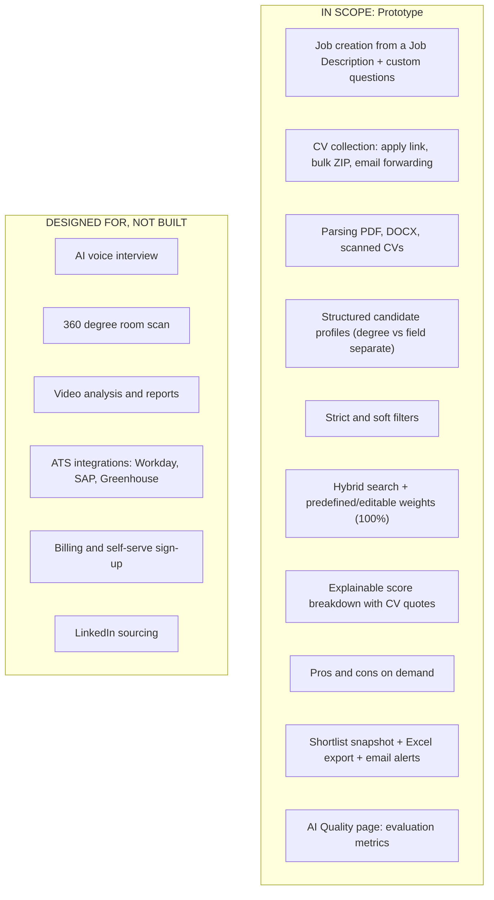

# 01. Vision & Scope

## The pitch in one sentence

> Recruiters get hundreds of CVs from many channels. Our platform **collects them in one place, understands them, and returns a ranked shortlist where every score is explained with evidence from the CV**, at less than one cent per CV.

## What the prototype must prove

| # | Question the company will ask | How the prototype answers it | Owner |
|---|---|---|---|
| 1 | Is the Top 10 actually right? | Measured ranking quality (NDCG@10) against HR-labelled data, compared with a keyword baseline (see [ADR-018](decisions/018-evaluation-strategy.md)) | Karim |
| 2 | Can a recruiter trust and defend the result? | Score breakdown + exact CV quotes as evidence + blind scoring + human makes the final decision | Karim + Abdallah |
| 3 | Does it handle real-world volume and mess? | Bulk upload of 1,000+ CVs, PDF/DOCX/scanned files, live progress, retries | Abdallah |
| 4 | Can it become a real SaaS company? | Multi-tenant design, Infrastructure as Code, two clouds, swappable providers, low cost per CV | Abdallah |

## Scope

> [!NOTE]
> LinkedIn scraping is **out of scope on purpose**. It breaks LinkedIn's Terms of Service and would be a red flag for a large partner company.

## Success criteria (proposal: agree in the meeting)

| Metric | Target for demo |
|---|---|
| Ranking quality (NDCG@10 vs HR labels) | Hybrid pipeline beats keyword baseline by ≥ 15% |
| Fairness swap test (change name/gender only) | Score change ≤ 1 point out of 100 |
| Ingestion throughput | 1,000 CVs fully indexed in ≤ 15 min |
| Ranking latency (rank 1,000 candidates for a job) | p95 ≤ 10 s, including evidence for the Top 30 |
| Parsing success rate | ≥ 97% of CVs parsed without manual fix |
| AI cost per CV | ≤ \$0.01 |
| Infra cost | ≤ agreed budget cap (proposal: \$100/month) |

## Personas

| Persona | Needs |
|---|---|
| **Recruiter** | Create job, collect CVs, see ranked list, understand *why*, shortlist, export |
| **Hiring manager** | Review shortlist and evidence quickly |
| **Candidate** | Apply in under 1 minute with a CV upload, no account needed |
| **Company admin (future)** | Manage team, data retention, audit logs |

## 🗳️ Meeting Decision

- Demo date: \_\_\_\_\_\_\_\_
- Demo format: ☐ Hosted self-serve ☐ Guided live demo
- Success criteria accepted: ☐ Yes ☐ Changed: \_\_\_\_\_\_\_\_
- Languages: ☐ English only ☐ Arabic + English
