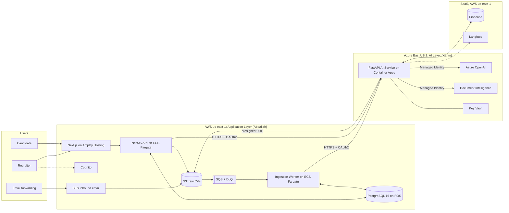
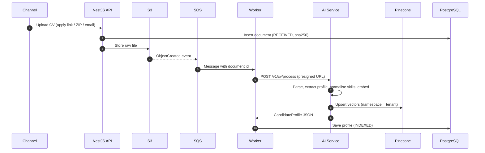
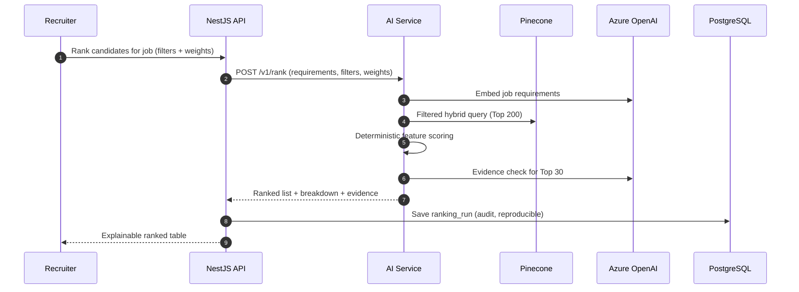

# 02. Architecture Overview

## 1. Big picture



## 2. The one rule that makes multi-cloud manageable

| | AWS side (NestJS) | Azure side (FastAPI) |
|---|---|---|
| Owns | Tenants, users, jobs, candidates, files, ranking history, shortlists, audit log | All AI logic: parse, extract, embed, retrieve, score, explain |
| State | **Stateful**: PostgreSQL + S3 | **Stateless**: only writes to Pinecone (a derived, rebuildable index) |
| Talks to the other side | Calls the AI service over a versioned REST contract (`/v1/...`) | Never connects to Postgres; gets files via 5-minute presigned URLs |

**Why it matters:** either side can move to the other cloud by changing adapters and Terraform only. If Pinecone is lost, re-run indexing from Postgres + S3.

## 3. CV ingestion flow



## 4. Ranking flow



## 5. Planned monorepo layout

```text
grad/
├── apps/
│   ├── web/          # Next.js (Abdallah)
│   ├── api/          # NestJS API + ingestion worker (Abdallah)
│   └── ai-service/   # Python FastAPI (Karim)
├── packages/
│   └── shared/       # Shared TS types, Zod schemas, generated OpenAPI client
├── eval/             # Datasets, labels, evaluation scripts (Karim)
├── infra/
│   ├── terraform/aws/
│   ├── terraform/azure/
│   └── docker/
├── docs/             # These documents
└── docker-compose.yml  # Local Postgres, MinIO (S3), LocalStack SQS
```

## 6. Environments

| Environment | Where | Purpose |
|---|---|---|
| `local` | Laptop: `docker compose` (Postgres, MinIO, LocalStack) + real Azure OpenAI / Pinecone `dev` namespace | Daily development |
| `demo` | AWS + Azure (Terraform) | What the company sees; seeded demo tenant |
| `prod` | Later, after funding | — |

> One cloud environment (`demo`) is enough for the prototype. A separate `staging` doubles infra cost with little benefit for 2 people.
