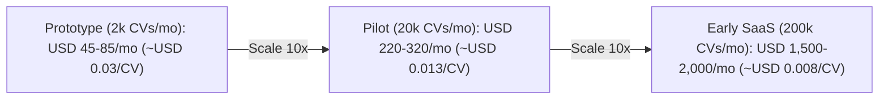

# 03. Cost Model

> All prices are **public list prices** (USD), AWS `us-east-1`, Azure `East US 2`, collected **Nov 2026**. Prices change. Check them in the official calculators before sharing outside the team. "≈" means rounded.

## 1. Unit price sheet

### AWS (application layer)

| Service | Price unit | Notes |
|---|---|---|
| ECS Fargate (Linux/x86) | ≈ \$0.0405 per vCPU-hour + \$0.0044 per GB-hour | 0.25 vCPU + 0.5 GB running 24/7 ≈ **\$9/month**. Fargate **Spot** ≈ 70% cheaper (for the worker) |
| ECS Fargate (ARM/Graviton) | ≈ 20% cheaper than x86 | Use ARM images where possible |
| Application Load Balancer | ≈ \$0.0225/hour + LCU usage | ≈ **\$18/month** minimum |
| NAT Gateway | ≈ \$0.045/hour + \$0.045/GB | ≈ **\$33+/month**. ⚠️ **Avoid in prototype**: use public subnets + security groups or VPC endpoints |
| Public IPv4 address | \$0.005/hour | ≈ \$3.65/month per IP |
| RDS PostgreSQL `db.t4g.micro` | ≈ \$0.016/hour | ≈ **\$12/month** + gp3 storage \$0.115/GB-month (20 GB ≈ \$2.3) |
| Aurora Serverless v2 (Postgres) | ≈ \$0.12 per ACU-hour, can pause at 0 ACU | Cold start after pause (~15 s), bad for live demo |
| S3 Standard | \$0.023/GB-month + requests | 10,000 CVs × 300 KB ≈ 3 GB ≈ **\$0.07** |
| SQS | First 1M requests/month free, then \$0.40/M | ≈ **\$0** |
| SES | \$0.10 per 1,000 emails sent; inbound \$0.10 per 1,000 emails | ≈ **\$0–1** |
| Cognito (Lite/Essentials) | Free up to 10,000 monthly active users (MAU) | ≈ **\$0** |
| Amplify Hosting | Build \$0.01/min; served data \$0.15/GB; SSR \$0.30 per 1M requests | ≈ **\$1–3** |
| Lambda (alternative) | 1M requests + 400k GB-seconds free/month | ≈ \$0 at prototype scale |
| API Gateway HTTP API | \$1.00 per 1M requests | ≈ \$0 |
| Secrets Manager | \$0.40 per secret/month | ~5 secrets ≈ \$2 |
| KMS | \$1 per key/month | ≈ \$1–2 |
| CloudWatch Logs | \$0.50 per GB ingested | ≈ \$1–3 (set log retention!) |
| ECR | \$0.10/GB-month | ≈ \$0.5 |
| Route 53 | \$0.50 per hosted zone + domain ≈ \$13/year | ≈ \$1.5 |
| Data transfer out | First 100 GB/month free, then ≈ \$0.09/GB | ≈ \$0 |

### Azure (AI layer)

| Service | Price unit | Notes |
|---|---|---|
| Container Apps (Consumption) | Monthly free grant: 180,000 vCPU-s + 360,000 GiB-s + 2M requests; then ≈ \$0.000024/vCPU-s | Scale-to-zero → ≈ **\$0–5** |
| Azure OpenAI **GPT-4.1-nano** | \$0.10 in / \$0.40 out per 1M tokens | Cheapest; weaker extraction |
| Azure OpenAI **GPT-4.1-mini** | \$0.40 in / \$1.60 out per 1M tokens (Global Standard) | ✅ Recommended baseline |
| Azure OpenAI **GPT-5-mini** | ≈ \$0.25 in / \$2.00 out per 1M tokens | Reasoning model; check availability + latency |
| Azure OpenAI **GPT-4.1** | \$2.00 in / \$8.00 out per 1M tokens | ~5× mini; use only if quality needs it |
| Azure OpenAI **GPT-5** | ≈ \$1.25 in / \$10.00 out per 1M tokens | Premium |
| `text-embedding-3-small` | \$0.02 per 1M tokens | 1536 dims |
| `text-embedding-3-large` | \$0.13 per 1M tokens | ✅ Recommended (truncate to 1024 dims) |
| Document Intelligence **Read** | ≈ \$1.50 per 1,000 pages | OCR text only |
| Document Intelligence **Layout** | ≈ \$10 per 1,000 pages | ✅ Markdown with structure |
| Document Intelligence **F0 (free)** | 500 pages/month, **only first 2 pages per document**, 4 MB max | ⚠️ Cuts long CVs |
| Azure AI Search Free | 50 MB, 3 indexes, 1,000 semantic queries/month | Too small |
| Azure AI Search Basic | ≈ \$74/month | Hybrid + semantic ranker |
| Azure AI Search S1 | ≈ \$245/month | |
| Azure Database for PostgreSQL (B1ms) | ≈ \$13–15/month | Alternative to RDS |
| Key Vault | ≈ \$0.03 per 10,000 operations | ≈ \$0 |
| Azure Monitor / Log Analytics | ≈ \$2.30/GB ingested (first 5 GB/month free) | ≈ \$0 |

### AWS AI alternatives (for comparison)

| Service | Price |
|---|---|
| Bedrock Claude Haiku 4.5 | ≈ \$1 in / \$5 out per 1M tokens |
| Bedrock Claude Sonnet 4.5 | ≈ \$3 in / \$15 out per 1M tokens |
| Bedrock Amazon Nova Lite | ≈ \$0.06 in / \$0.24 out per 1M tokens |
| Bedrock Titan Text Embeddings v2 | ≈ \$0.02 per 1M tokens |
| Textract DetectDocumentText | ≈ \$1.50 per 1,000 pages |
| Textract AnalyzeDocument (Layout) | ≈ \$4 per 1,000 pages |
| Cohere Rerank 3.5 (Bedrock / Azure Foundry) | ≈ \$2 per 1,000 queries |

### SaaS

| Service | Free tier | Paid |
|---|---|---|
| **Pinecone** | Starter: 2 GB, 1M read units, 2M write units/month, 5 indexes, `us-east-1` only, 5M inference tokens, 500 rerank requests | Standard: **\$50/month minimum**, ≈ \$0.33/GB-month, ≈ \$16/M read units, ≈ \$4/M write units |
| Qdrant Cloud | 1 GB cluster free | Usage-based from ≈ \$25/month |
| Neon Postgres | 0.5 GB, scale-to-zero | From ≈ \$19/month |
| Supabase | 500 MB DB, pauses after 7 days idle | \$25/month |
| MongoDB Atlas | M0 512 MB (with vector search) | From ≈ \$57/month (M10) |
| Langfuse Cloud | Hobby: 50k units/month | Core ≈ \$29/month |
| Sentry | Developer: 5k errors/month | Team ≈ \$26/month |
| Clerk | 10k monthly users | Pro \$25/month |
| Auth0 | 25k MAU (B2C free) | B2B from ≈ \$150/month |
| Vercel | Hobby (non-commercial only) | Pro \$20/user/month |
| GitHub Actions | 2,000 min/month (private repos, Free plan) | \$0.008/min Linux |
| HCP Terraform | Free up to 500 managed resources | — |

---

## 2. AI cost per CV (the number the company will ask about)

**Assumptions:** an average CV is about 2,000 tokens of text. The extraction prompt + schema add about 1,000 tokens. The JSON output is about 800 tokens. Six section embeddings per CV add about 2,000 embedding tokens in total.

| Step | Model | Calculation | Cost per CV |
|---|---|---|---|
| Extraction | GPT-4.1-mini | 3,000 × \$0.40/M + 800 × \$1.60/M | **\$0.0025** |
| Embeddings | text-embedding-3-large | 2,000 × \$0.13/M | **\$0.0003** |
| Parsing (only ~20% of CVs need Layout) | Doc Intelligence Layout | 0.2 × 2 pages × \$0.01 | **\$0.004** |
| **Total ingestion** | | | **≈ \$0.003–0.007** |

**Per ranking run** (evidence check on the Top 30): 30 × (2,500 in + 400 out tokens) on GPT-4.1-mini ≈ **\$0.05 per run**.

| Model choice for extraction | Cost per 1,000 CVs |
|---|---|
| GPT-4.1-nano | ≈ \$0.6 |
| GPT-4.1-mini ✅ | ≈ \$2.5 |
| GPT-5-mini | ≈ \$2.4 + reasoning tokens (≈ \$3–5) |
| GPT-4.1 | ≈ \$12.4 |
| Claude Sonnet 4.5 (Bedrock) | ≈ \$21 |

---

## 3. Monthly scenarios

| Item | Prototype (2k CVs/mo) | Pilot (20k CVs/mo, 1 customer) | Early SaaS (200k CVs/mo) |
|---|---|---|---|
| Azure OpenAI (extraction + embeddings + ranking runs) | \$5–10 | \$60–80 | \$600–800 |
| Document Intelligence | \$0–10 | \$80 | \$800 → mitigate with local parsing |
| Container Apps | \$0–5 | \$10–20 | \$60–120 |
| Vector DB | \$0 (Pinecone Starter) | \$50 (Pinecone Standard min) or \$0 (pgvector) | \$70–150 |
| RDS PostgreSQL | \$14 (t4g.micro) | \$30 (t4g.small) | \$130+ (t4g.large, Multi-AZ x2) |
| ECS Fargate (API + worker) | \$10–15 | \$30–40 | \$120–200 |
| ALB | \$18 | \$20 | \$25–40 |
| S3, SQS, SES, Cognito, Amplify, logs, secrets | \$5–8 | \$15–25 | \$60–120 |
| Langfuse / Sentry | \$0 | \$0–29 | \$55+ |
| **Total (approx.)** | **\$45–85** | **\$220–320** | **\$1,500–2,000** |
| **Cost per CV** | ~\$0.03 (fixed infra dominates) | ~\$0.013 | ~\$0.008 |

> [!TIP]
> At small scale, **fixed infrastructure** (ALB, RDS, Fargate) costs more than AI. Biggest saving options: (1) drop the ALB by using API Gateway → Lambda or a single Fargate task with a public IP (−\$18); (2) use pgvector instead of Pinecone once past the free tier (−\$50 at pilot).

## 4. Credits to apply for (can make the prototype free)

| Program | Typical value | Who applies |
|---|---|---|
| AWS Activate Founders | \$1,000 credits (more via accelerators/VCs) | ☐ |
| Microsoft for Startups (Founders Hub) | Azure credits from \$1,000 up to \$5,000+, plus OpenAI benefits | ☐ |
| Azure for Students | \$100 / year (student email, no card) | ☐ both of us |
| AWS Educate / free-plan credits | New AWS accounts get starter credits (\$100–200) | ☐ |
| Pinecone for Startups | Usage credits (application) | ☐ |
| GitHub Student Developer Pack | Many free tools/credits | ☐ |

## 5. Cost guardrails (day 1)

- AWS Budgets alert at 50% / 80% / 100% of the cap; Azure Cost Management alert the same.
- CloudWatch log retention = 14 days; Log Analytics retention = 30 days.
- No NAT Gateway, no Multi-AZ, no provisioned throughput in the prototype.
- Azure OpenAI: set a **per-deployment TPM limit** so a bug can't burn money.
- Tag every resource: `project=cv-ranker`, `env=demo`, `owner=<name>`.

## 🗳️ Meeting Decision

- Monthly budget cap: \_\_\_\_\_\_ USD
- Model tier for extraction: ☐ nano ☐ **mini** ☐ full
- Accept ALB cost or use cheaper ingress: ☐ ALB ☐ API Gateway + Lambda ☐ Other
- Credits owners: \_\_\_\_\_\_\_\_
