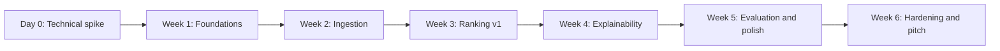

# 04. Roadmap: 6-Week Prototype

> Assumes about 6 weeks with 2 people part- or full-time. Change the dates in the meeting.

## Day 0: Technical spike (1 day, both)

Goal: check the riskiest assumptions **before** building anything.

- [ ] Parse 20 real CVs (English + Arabic, 1 scanned, 1 two-column).
- [ ] Extract profiles with GPT-4.1-mini Structured Outputs and check accuracy by hand.
- [ ] Embed and upsert to Pinecone, then run 1 ranking query for 1 JD.
- [ ] Measure the real token cost and latency AWS → Azure → Pinecone.
- **Exit criteria:** extraction ≥ 90% field accuracy, cost per CV ≤ \$0.01.

## Week-by-week plan

| Week | Karim (Team Lead): Azure, FastAPI, AI | Abdallah: AWS, NestJS, Next.js, DevOps | Demo-able outcome |
|---|---|---|---|
| **1** | Terraform Azure (Container Apps, Azure OpenAI, Doc Intelligence, Key Vault); FastAPI skeleton; **OpenAPI contract v1**; start building the dataset | Monorepo (Turborepo/pnpm); Terraform AWS (VPC, RDS, S3, SQS, ECR, ECS, Cognito); GitHub Actions with OIDC; Prisma schema v1 | Both clouds deployed; authenticated call AWS → Azure works |
| **2** | `/v1/cv/process`: local parsing + Doc Intelligence fallback, Structured Outputs, skill normalisation, embeddings, Pinecone upsert | Jobs CRUD + public apply link; bulk ZIP upload; SES email ingestion; SQS worker; live status UI | Upload 200 CVs → all parsed and indexed with live progress |
| **3** | `/v1/jobs/requirements`; `/v1/rank`: filters, hybrid recall, RRF, feature scoring | Job wizard (JD → editable requirements); strict/soft filter drawer; weight sliders (sum = 100%) | First ranked list for a real job |
| **4** | LLM evidence check (validated quotes); `/v1/explain` pros/cons; blind-scoring guard | Ranking table with expandable breakdown; side-by-side CV viewer with highlighted evidence; shortlist; Excel export | "Why is this candidate #1?" answered with CV quotes |
| **5** | Evaluation harness (NDCG@10, P@10, MRR), baselines, fairness swap test; prompt tuning in Langfuse | Labelling UI for HR reviewers; "AI Quality" dashboard; recruiter analytics (funnel, sources) | Chart: our ranking vs keyword baseline |
| **6** | Cost + latency report; failure handling; freeze model + prompt versions | Load test (1,000 CVs); security review; delete-candidate cascade; demo tenant + seed data; custom domain | **Pitch-ready demo + architecture deck** |

## Shared rituals

| When | What |
|---|---|
| Daily (15 min, async OK) | What I did / will do / blockers |
| Every Thursday | Demo to each other on the `demo` environment |
| Every PR | Reviewed by the other person; CI must pass |
| End of week | Update ADR status + cost check vs budget |

## Definition of Done (prototype)

- [ ] Deployed fully by Terraform + CI (no manual console changes)
- [ ] Success criteria in [01-vision-and-scope.md](01-vision-and-scope.md) met and measured
- [ ] Demo script rehearsed twice; demo works offline from seeded data if the network fails
- [ ] Architecture deck + cost-per-CV slide + AI Quality slide ready

## 🗳️ Meeting Decision

- Start date: \_\_\_\_\_\_ · Demo date: \_\_\_\_\_\_
- Spike owner(s): \_\_\_\_\_\_
- Task tracker: ☐ GitHub Projects ☐ Linear ☐ Jira ☐ Other
