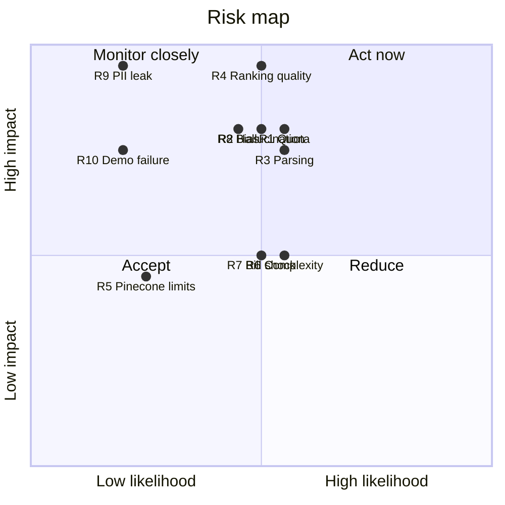

# 05. Risk Register

Likelihood and impact: **H** = high, **M** = medium, **L** = low.

| # | Risk | Likelihood | Impact | Mitigation | Owner |
|---|---|---|---|---|---|
| R1 | Azure OpenAI access/quota is delayed or too low (tokens-per-minute) | M | H | Request access **today**; queue-based back-pressure; pre-index demo data; Bedrock adapter as backup | Karim |
| R2 | LLM makes up skills or quotes | M | H | Evidence quotes must be exact substrings of the CV, otherwise dropped; temperature 0; Structured Outputs | Karim |
| R3 | Poor parsing of scanned / two-column / Arabic CVs | M | H | Text-density check → Document Intelligence Layout; `extraction_confidence` shown in UI; include such CVs in the spike | Karim |
| R4 | Ranking not clearly better than keyword search | M | **Critical** | Evaluation harness from week 3; tune weights; add structured features; show the comparison honestly | Karim |
| R5 | Pinecone free-tier limits (region lock, 500 reranks, inactivity) | L | M | Pinecone rerank not used; `VectorStore` interface; pgvector adapter can rebuild the index from Postgres | Karim |
| R6 | Two clouds too complex for 2 people | M | M | Stateless AI boundary; one Terraform repo; OIDC CI/CD; local docker compose | Abdallah |
| R7 | Surprise cloud bill (NAT Gateway, logs, runaway loop) | M | M | Budgets + alerts day 1; no NAT; log retention; per-deployment TPM caps | Abdallah |
| R8 | Bias in rankings (gender, name, age, nationality) | M | H | Blind scoring; fairness swap test; human-in-the-loop; audit log | Both |
| R9 | Personal-data leak (CVs are PII) | L | **Critical** | Private S3 + KMS; presigned URLs (5 min); no PII in logs/traces; least-privilege IAM | Abdallah |
| R10 | Demo fails live (network/cloud outage) | L | H | Seeded demo tenant; cached ranking runs; recorded backup video | Abdallah |
| R11 | Scope creep (Phase 2 features requested early) | M | M | Show the Phase 2 design in the deck, but don't build it | Both |
| R12 | Company asks for on-prem / its own cloud | L | M | Containers + Terraform + adapters make this a migration, not a rewrite | Abdallah |
| R13 | One team member unavailable | M | H | Both review all PRs; docs + ADRs; no single-owner secrets (shared vault) | Both |
| R14 | Vendor or model deprecation (models retire every ~12 months on Azure) | M | L | Model name in config; eval harness re-run on model change | Karim |

> Note: `quadrantChart` needs a recent Mermaid version. If it doesn't render, use the table above.
