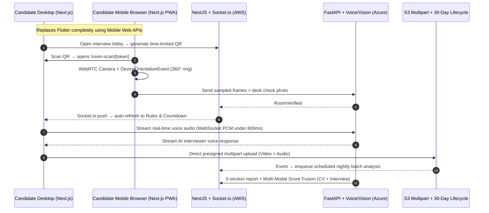

# 07. Future Evolution: Prototype → Pilot → Full Startup Product

> One core goal of this meeting is choosing technologies for the **prototype** that we **do not throw away** when the company funds the startup or when we build Phase 2.

```mermaid
flowchart LR
    subgraph P1["Stage 1: Prototype (Now, 6 Weeks)"]
        S1A["Next.js + NestJS + Postgres"]
        S1B["Azure Container Apps + AOAI mini + Doc Intel"]
        S1C["Pinecone Starter Free"]
        S1D["Local + S3 + SQS + Cognito"]
    end

    subgraph P2["Stage 2: Paid Pilot (Months 2–4)"]
        S2A["Same codebase + Terraform workspaces"]
        S2B["Pinecone Standard OR pgvector / Azure AI Search"]
        S2C["Enterprise SSO (SAML) + ATS Webhooks"]
        S2D["Custom Data Retention + Multi-AZ RDS"]
    end

    subgraph P3["Stage 3: Full Startup + Phase 2 (Months 5+)"]
        S3A["Socket.io Desktop QR Pairing"]
        S3B["Mobile Web 360° Room Scan (Camera + Gyroscope)"]
        S3C["Real-Time Voice Interview Agent (under 800ms)"]
        S3D["Batch Video Analysis Workers + Multi-Modal Score Fusion"]
    end

    P1 -->|"Config & Terraform scale-up (0 rewrites)"| P2
    P2 -->|"Add Phase 2 modules to same monorepo"| P3
```

---

## 1. What Never Changes (Zero-Rewrite Core)

| Component | Why it scales from 1,000 CVs to 1,000,000+ CVs |
|---|---|
| **Next.js + React + shadcn/ui** | Same frontend adds the Phase 2 interview lobby, Web Audio visualizer, HTTP 206 video player, and mobile web `/room-scan/[token]` route with zero native app overhead. |
| **NestJS + Prisma** | Modular monolith grows cleanly by adding `InterviewsModule`, `MediaModule`, and `SsoModule`. Same container image scales horizontally on ECS Fargate. |
| **PostgreSQL** | Handles multi-tenant RLS, JSONB score snapshots, audit trails, and can absorb vector search (`pgvector`) if we ever drop Pinecone. |
| **Python FastAPI AI Service** | Same stateless HTTP/WebSocket service scales on Azure Container Apps or dedicated GPU workers for Phase 2 voice/video workloads. |
| **Terraform + GitHub Actions** | Moving from single-AZ `demo` to multi-AZ `prod` or regional deployments (EU/UAE for data residency) is variable changes, not manual clicking. |

---

## 2. How Each Layer Upgrades Without Rewriting

| Area | Prototype (Today) | Paid Pilot (1–5 Companies) | Enterprise SaaS (Scale) |
|---|---|---|---|
| **Vector Search** | Pinecone Starter (free, 2 GB, `us-east-1`) | Flip adapter to **pgvector** (\$0 extra) OR **Pinecone Standard** (\$50+/mo) OR **Azure AI Search Basic** (\$74+/mo for native semantic reranker) | Dedicated vector cluster or regional Azure AI Search with customer isolation |
| **AI Compute** | Azure Container Apps (`minReplicas=0`) | `minReplicas=1–2` for zero cold start; Azure OpenAI Provisioned or higher TPM quota | Separate real-time voice pods + GPU spot batch workers for offline video analysis |
| **CV Ingestion** | Apply link, Bulk ZIP, SES Email | Add Google Drive / SharePoint sync + Greenhouse / Workday / Lever ATS integrations | Bi-directional ATS sync + custom webhook pipelines |
| **Database & Network** | RDS `db.t4g.micro` Single-AZ, public subnets w/ SG (no NAT) | RDS Multi-AZ, NAT Gateway or VPC Endpoints, Postgres Row-Level Security | Read replicas, cross-region DR, customer-managed KMS keys (CMK) |
| **Security & Auth** | Cognito email/password + OAuth2 client-credentials AWS→Azure | Cognito SAML/OIDC Enterprise SSO + AWS↔Azure Workload Identity Federation | SOC 2 Type II, EU AI Act audit export, private AWS/Azure interconnects |

---

## 3. How Phase 2 (Virtual Interviews & Room Scan) Plugs In

When the startup moves beyond CV ranking into the full platform from our master specification:

### Why our prototype stack is already Phase-2-ready:
- **No Flutter bottleneck:** Mobile Safari & Chrome support `getUserMedia` (camera) and `DeviceOrientationEvent` (gyroscope), so the 360° room scan runs in the exact same Next.js app.
- **Socket.io already fits NestJS:** Adding `@nestjs/websockets` for instant desktop QR handoff takes hours, not weeks.
- **S3 Presigned Multipart + HTTP 206 Range:** Already using S3 for CVs means large interview video uploads never touch NestJS memory, and 30-day GDPR auto-deletion uses S3 Lifecycle Rules we already define in Terraform.
- **Scheduled Batch Workers:** Adding BullMQ or AWS EventBridge Scheduler for off-peak video analysis reuses the exact same `SQS / Worker` decoupling pattern built in Week 2.

---

## 🗳️ Meeting Decision

- Agree on keeping all provider interfaces (`LLMProvider`, `DocumentParser`, `VectorStore`, `ObjectStorage`) lightweight but present from Week 1? ☐ Yes ☐ No
- Any Phase 2 teaser/mockup needed in the pitch deck (without building Phase 2 code)? ☐ Yes (architecture slide) ☐ No
