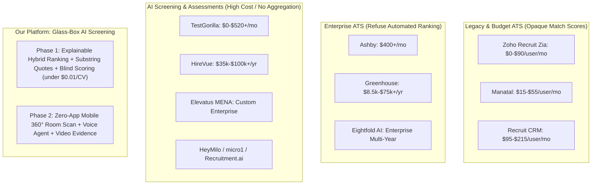
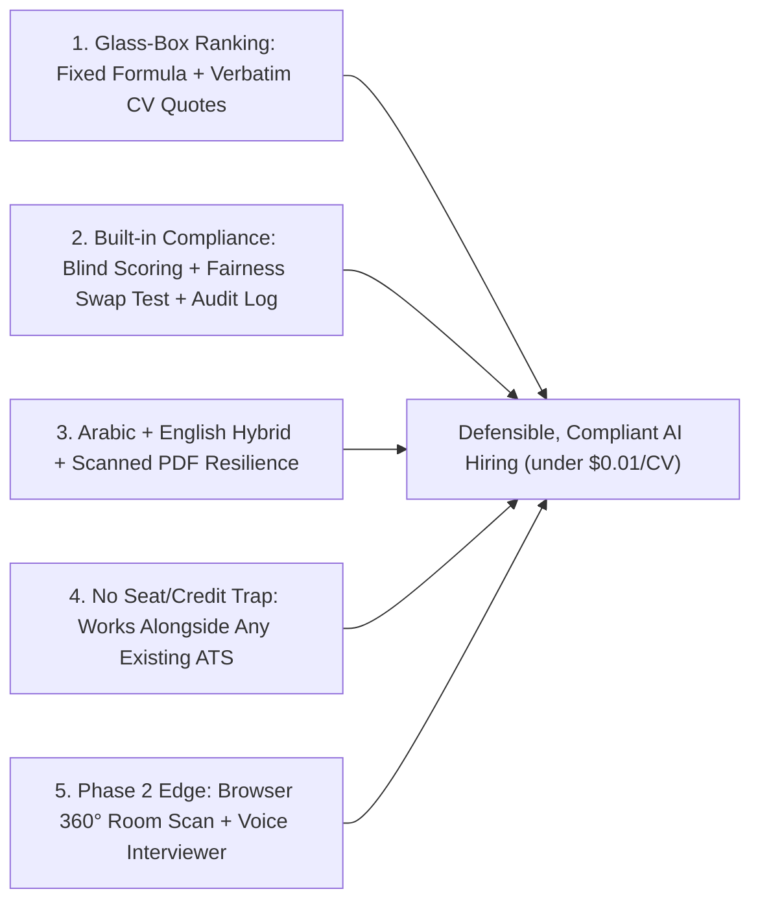

# 08. Competitor Analysis, Differentiation & Product Suggestions

> Based on live market research (Nov 2026) covering the 9 competitors/domains you listed plus major global and MENA platforms.

---

## 1. Where Competitors Sit (Market Positioning Map)

---

## 2. Detailed Competitor Breakdown (Your List + Global & MENA Leaders)

### Group A: The Competitors & Domains You Specified

| Competitor | Category & Target | Pricing (Verified Nov 2026) | Strengths | Weaknesses / Gaps We Beat |
|---|---|---|---|---|
| **[Atlas](https://recruitwithatlas.com/ai-powered-ats/)** | AI-native ATS + CRM for staffing agencies & exec search | ~£105–£135/user/mo (annual 12-mo contract); Enterprise custom | Fast modern UI, "Total Memory" indexing emails/calls/LinkedIn, "Ask AI" citations | **12-month lock-in**, agency/exec-search focus rather than high-volume corporate inbound screening, limited MENA/Arabic localization |
| **[TestGorilla](https://www.testgorilla.com/)** | Pre-employment skills tests + async AI video screening | Free (10 credits/mo); Core ~\$215/mo annual; Plus ~\$520/mo annual | 350+ validated tests, tab-switch anti-cheating, free basic resume scoring | **ATS integrations locked behind Plus (~\$6.2k/yr)**, annual upfront billing, unused credits expire, no deep hybrid CV aggregation across email/LinkedIn/ZIP |
| **[Recruit CRM](https://recruitcrm.io/)** | Agency ATS + CRM with GPT agents | ~\$95–\$215/user/mo + shared AI credit pool | Strong client-management CRM, AI submission agent, X-ray & voice search | **Expensive per-seat pricing** for internal HR, metered AI credit pools, agency-focused workflow |
| **[Manatal](https://www.manatal.com/)** | Budget SMB ATS + AI recommendation | \$15/user/mo (Pro), \$35 (Ent), \$55 (Ent Plus) | Very cheap entry, multilingual CV parsing, optional AI Interviewer add-on | Pro plan **caps at 15 active jobs & 10k candidates**; match score is **opaque** (no verbatim quote verification, no strict/soft mathematical slider formula, no blind-scoring audit) |
| **[Zoho Recruit](https://www.zoho.com/ar/recruit/ai-recruitment.html)** (Arabic + Zia AI) | General SMB/Mid ATS in Zoho suite | Free (1 job); \$25–\$90/user/mo + add-ons | Arabic UI available, Zia candidate matching on Professional+, cheap if using Zoho CRM | **Black-box Zia match %** without quote-level explainability, dated UX, rigid Zoho ecosystem lock-in, no physical anti-cheating room scan |
| **[AI-Recruit.io](https://ai-recruit.io/)** | People search connector (MCP for Claude/Cursor) | Free (50 searches), Lite \$25/mo, Standard \$75/mo | Novel developer-centric semantic people search (e.g. localized Japan talent) | **Not an ATS or CV ranking platform** — cannot ingest bulk/email CVs or run explainable shortlisting |
| **[AI-recruit.com](https://www.ai-recruit.com/)** & **[AI Recruit (`ai-recruit.co`)](https://ai-recruit.co/)** | Tech/AI boutique headhunting & talent agencies | Agency placement fees (not B2B SaaS) | Domain expertise in hiring ML/AI engineers | **Service agencies, not competing software** *(Note: separate from `airecruittalent.com`, a \$10–\$19/mo budget matching tool)* |
| **[Recruitment.ai](https://recruitment.ai/)** | AI interactive avatar/conversational screening | SMB avatar/screening peers range ~\$49–\$399+/mo or ~\$7–\$15/interview | Automated top-of-funnel avatar interviews, reduces silent rejections | Focuses on avatar interviews; lacks multi-channel CV aggregation + deterministic strict/soft profile weights + verified CV substring citations + physical room scan |

---

### Group B: Major Global & MENA Competitors You Should Know Before Pitching

| Competitor | Region / Segment | Pricing (Nov 2026) | Key Insight for Our Pitch |
|---|---|---|---|
| **Elevatus** *(Direct MENA Competitor!)* | Saudi / UAE / GCC Enterprise & Government | Quote-only enterprise contracts (expensive) | Strong Arabic/English + *EVA-REC* ranking + *EVA-SSESS* video. **Weakness:** high cost barrier, steep learning curve, crowded UI, and uses psychological Five-Factor personality scoring from video — risky under EU AI Act & modern Responsible AI standards. |
| **Ashby** & **Greenhouse** | Modern Tech Scale-ups & Enterprises | Ashby ~\$400+/mo; Greenhouse ~\$8.5k–\$75k+/yr | **Crucial Insight:** Both deliberately **avoid automated numeric candidate ranking** out of EU AI Act / bias liability fear! Our **deterministic formula + blind scoring + verbatim quote verification** directly solves what makes them afraid to rank. |
| **Workable** | Global SMB / Mid-Market | \$299–\$719+/mo + AI credit top-ups | Good autonomous AI screening agent, but costs balloon with AI credit top-ups and add-ons (realistic ~\$556+/mo). |
| **Dover** | Startups | \$0 free ATS; \$199+/mo Premium + recruiter marketplace | Freemium ATS wedge; monetizes via fractional recruiters rather than deep enterprise AI governance. |
| **Eightfold AI** & **SeekOut** | Fortune 500 Talent Intelligence | Custom multi-year enterprise contracts | Massive implementation lag (months), requires clean legacy HRIS data, prohibitive cost for mid-market. |
| **Juicebox (PeopleGPT)** | Outbound AI Sourcing | \$99–\$199/mo + \$199/mo per autonomous agent | Great conversational search over public web data, but **siloed** (still needs an ATS) and relies on public profile scraping + strict contact credits. |
| **HireVue / HeyMilo / micro1** | Phase 2 Benchmark (Voice/Video AI) | HireVue \$35k–\$100k+/yr; HeyMilo ~\$6–\$8/interview; micro1 ~\$99–\$399/mo | None of them solve **physical off-screen cheating** with a zero-app mobile browser 360° room scan paired over WebSockets! |
| **Paradox (Olivia)** & **Metaview** | Frontline Chat / Interview Notetaker | Paradox ~\$12k–\$95k+/yr; Metaview \$100–\$300/user/mo | Paradox excels at SMS/WhatsApp frontline hiring; Metaview excels at live Zoom/Meet interview scorecards. |

---

## 3. What Makes Us Better: 6 Core Differentiators

1. **Glass-Box Deterministic Ranking + Substring-Verified Evidence:**
   Unlike Manatal, Zoho Zia, and Elevatus (which give opaque "85% match" numbers) and unlike Ashby/Greenhouse (which avoid ranking altogether), our score comes from a **transparent mathematical formula** tuned by recruiter sliders (summing to 100%, Strict vs. Soft modes) while the LLM must attach **exact substring quotes from the CV**. If a quote isn't verbatim in the CV, it is dropped automatically.
2. **Compliance-by-Design (EU AI Act + Egypt/GCC PDPL):**
   Blind scoring strips name, gender, age, photo, and nationality before scoring; `ranking_run` logs every prompt/weight/model version for auditability; our evaluation harness runs an automated **name/gender fairness swap test**; and we never infer suitability from facial expressions or psychological personality guessing.
3. **True Bilingual (Arabic + English) & Messy CV Resilience at 10× Lower Price Than Elevatus:**
   Western tools struggle with Arabic CVs and two-column Canva/scanned PDFs. Smart routing parses clean CVs locally for \$0 and routes scanned/complex files through Azure Document Intelligence Layout → Markdown + multilingual `text-embedding-3-large` vectors.
4. **Zero "Credit Surprise" Economics (< \$0.01 AI Cost per CV):**
   Instead of \$95–\$215/seat + metered AI credit pools (Recruit CRM, Workable, Juicebox) or \$35k+/yr floors (HireVue, Greenhouse, Eightfold), our serverless multi-cloud stack keeps AI processing under 1 cent per CV.
5. **Plug-In AI Brain (No Rip-and-Replace Required):**
   Companies hate migrating off Workday, Greenhouse, BambooHR, or Odoo. Our `IntakeConnector` works *on top* of their existing workflow via email intake (`jobs+<slug>@`), bulk ZIP, and Unified ATS sync (`Unified.to` / `Merge`).
6. **Unmatched Phase 2 Anti-Cheating Roadmap (Beyond Prototype):**
   Competitors like TestGorilla only detect browser tab switches, and HireVue/HeyMilo cannot see what is next to a candidate's laptop. Our Phase 2 architecture adds a **zero-install Mobile Browser 360° Room Scan** + **sub-second scenario voice interview** + **timestamped video review**.

---

## 4. High-Impact Suggestions to Beat Competitors (For Prototype & Pilot)

### Quick Wins for the 6-Week Prototype (High Demo Impact, Low Effort)
1. **"Blind Review Mode" Toggle in the Recruiter UI:**
   Let the recruiter hide candidate names, emails, and photos in the ranking table with one click during initial shortlisting (directly answers enterprise DE&I / bias objections better than Zoho or Manatal).
2. **Live "Filter Impact Counter" (Strict vs. Soft Calibration):**
   As the recruiter toggles a criterion between `Strict` and `Soft`, show `"420 → 38 candidates remain"` in real time so they never accidentally exclude great candidates because of an overly rigid strict filter.
3. **"Hidden Gems / Silver Medalists" Cross-Job Search:**
   Inspired by Atlas & Manatal: since all CVs live in our tenant Pinecone namespace, let recruiters click **"Search All Past Applicants"** when opening a *new* job to instantly re-rank candidates who applied to earlier roles.
4. **Anti-Spam & Keyword-Stuffing Anomaly Flag:**
   Inspired by Greenhouse *Real Talent*: detect duplicate SHA-256 submissions, abnormal hidden/white-text keyword stuffing during PDF parsing, or suspiciously low-confidence parses and flag them for recruiter review.

### Smart Additions for Pilot / Phase 2
5. **WhatsApp & Email Candidate Status / Intake Bot (Inspired by Paradox Olivia):**
   Huge differentiator in Egypt & GCC — candidates can upload a PDF CV directly on WhatsApp or receive interview scheduling links without friction.
6. **Constructive Candidate Feedback Export (Fixes "Silent Rejections"):**
   Generate an optional, privacy-safe 3-bullet skills-gap note for rejected/interviewed candidates (never exposing competitor ranks or internal recruiter notes).
7. **Live Interview Scorecard Copilots (Competes with Metaview):**
   Even when human managers run the final interview on Zoom/Teams/Meet, reuse our transcription + rubric-evidence engine to auto-fill structured human scorecards.

---

## 🗳️ Meeting Decision

- Which **2–3 competitors** does the partner company currently use or compare us against? \_\_\_\_\_\_
- Which prototype differentiator demos should we highlight first?
  ☐ Blind Review UI Toggle
  ☐ Live Strict/Soft Filter Impact Counter
  ☐ Search Past Talent Pool ("Silver Medalists")
  ☐ Measured NDCG@10 + Fairness Swap Chart (AI Quality Page)
- Include keyword-stuffing / duplicate CV anomaly flags in Phase 1? ☐ Yes ☐ Pilot
