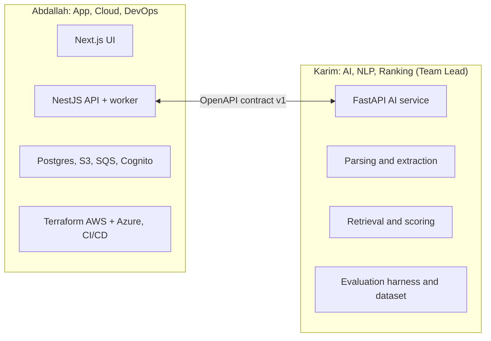

# ADR-001: Team & Ownership Split

| Field | Value |
|---|---|
| Status | 🟡 Proposed |
| Owner | Both |
| Reversal cost | Low |

## Context
The team went from 4+ members (and a 24-person original plan) to **2 people**. The old split (one person per language: .NET, Flutter, Angular, Python) created silos and duplicated UIs. We need a split that lets both people work in parallel with few blockers, while either person can still cover for the other.

## Options

| Option | Pros | Cons |
|---|---|---|
| **A. By layer/cloud**: Abdallah = AWS app (Next.js, NestJS, DevOps); Karim = Azure AI (FastAPI, ranking, evaluation) ✅ | Matches skills; clear contract (OpenAPI) between the two; parallel work | Risk of silos; needs cross-review |
| B. By feature (each person builds features end-to-end) | Both learn everything | Two people editing AI + UI + infra at once → conflicts, slower |
| C. Pair on everything | Max knowledge sharing | Half the throughput; too slow for 6 weeks |

## Recommendation
**Option A**, plus three rules against silos:
1. **Every PR is reviewed by the other person.**
2. **The OpenAPI contract** (`/v1/...`) is designed together in week 1 and changed only by agreement.
3. Both people can run the full stack locally with one command (`docker compose up` + `.env`).

| Area | Responsible | Reviewer |
|---|---|---|
| Next.js frontend | Abdallah | Karim |
| NestJS API, DB schema, ingestion | Abdallah | Karim |
| Terraform (AWS + Azure), CI/CD, security | Abdallah | Karim |
| AI service, prompts, models | Karim | Abdallah |
| Ranking formula + weights | Karim | Abdallah |
| Evaluation dataset + metrics | Karim | Abdallah |
| Talking to the company / pitch deck | Karim (lead) | Abdallah |
| Cost tracking | Abdallah | Karim |

## 🗳️ Meeting Decision
- Decision: ☐ Accept ☐ Change: \_\_\_\_\_\_
- Company contact person: \_\_\_\_\_\_
