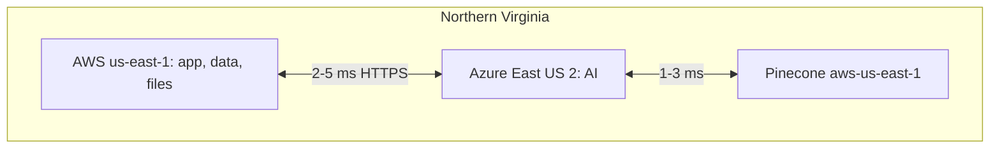

# ADR-002: Cloud Strategy (Multi-Cloud AWS + Azure)

| Field | Value |
|---|---|
| Status | 🟡 Proposed (team pre-decision: AWS for app, Azure for AI) |
| Owner | Abdallah |
| Reversal cost | Medium (low if we keep the stateless boundary) |

## Context
The team decided: **Azure for AI services, AWS for the application**, interchangeable when one cloud has a better service. Multi-cloud adds complexity, so we have to keep it simple on purpose.

## Options

| Option | Pros | Cons | Extra cost |
|---|---|---|---|
| **A. AWS app + Azure AI (split)** ✅ | Uses Azure OpenAI (strong enterprise trust, Structured Outputs) **and** AWS app maturity; good "multi-cloud" story for a large company; avoids lock-in | Two consoles, two IaC providers, cross-cloud auth, small egress | ≈ \$0 (egress is tiny: KBs of JSON per CV) |
| B. All AWS (Bedrock for AI) | One cloud, one IAM, simplest | Bedrock models (Claude) cost more for extraction; loses Azure Document Intelligence Layout quality; team already prefers Azure AI | \$0 |
| C. All Azure (Container Apps, Azure Postgres, Blob) | One cloud, Managed Identity everywhere, free Container Apps grant | Less mature for the app side we know; team decision says AWS for app | \$0 |
| D. Vendor platforms (Vercel + Supabase + OpenAI direct) | Fastest to build | Weaker "enterprise" story; harder data-residency answers; lock-in | \$0–45 |

## Key design rules (to make A manageable)

1. **Same physical region:** AWS `us-east-1` + Azure `East US 2` + Pinecone `aws-us-east-1` are all in Northern Virginia, so cross-cloud latency is about **2–5 ms**.
2. **Stateless AI boundary:** Azure never holds the source of truth (see [02-architecture-overview.md](../02-architecture-overview.md)).
3. **Containers everywhere:** the same Docker images run on ECS or Container Apps.
4. **One Terraform repo** with `aws` and `azurerm` providers.
5. **Adapters for providers** (`LLMProvider`, `DocumentParser`, `VectorStore`, `ObjectStorage`, `Queue`), chosen by config.

## Interchangeability matrix ("use whichever cloud is better")

| Capability | Prototype choice | Alternative on the other cloud | When to switch |
|---|---|---|---|
| LLM | Azure OpenAI | AWS Bedrock (Claude, Nova) | If Azure quota is blocked or a Bedrock model wins our eval |
| Document parsing | Azure Document Intelligence | AWS Textract | If Textract Layout is cheaper at scale (≈ \$4 vs \$10 per 1k pages) |
| Embeddings | Azure OpenAI | Bedrock Titan v2 / Cohere | Rarely; re-embedding everything is required |
| Containers | ECS Fargate / Container Apps | Swap | Cost or customer requirement |
| Database | RDS Postgres | Azure Database for PostgreSQL | Customer's cloud preference |
| Object storage | S3 | Azure Blob | Customer's cloud preference |
| Queue | SQS | Azure Service Bus | Same |
| Search | Pinecone | Azure AI Search | If we want native semantic reranking at paid tier |

## Data residency note
For customers in the EU or Middle East we can later deploy the same stack in `eu-central-1` + `Germany West Central`, or `me-central-1` (UAE) + `UAE North`. Pinecone paid plans offer EU regions. Keep region as a Terraform variable from day 1.

## 🗳️ Meeting Decision
- Decision: ☐ Accept A ☐ B ☐ C ☐ D
- Regions: ☐ us-east-1 / East US 2 (recommended for free Pinecone) ☐ Other: \_\_\_\_\_\_
