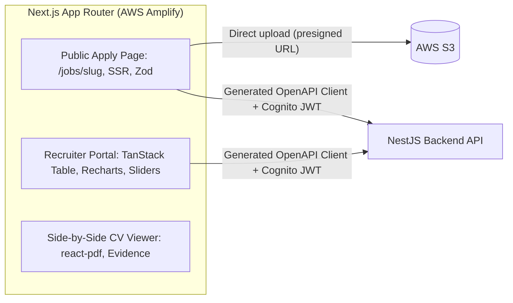

# ADR-003: Frontend Framework

| Field | Value |
|---|---|
| Status | 🟡 Proposed |
| Owner | Abdallah |
| Reversal cost | High (UI rewrite) |

## Context
We need a recruiter dashboard (tables, filters, sliders, charts, PDF viewer with highlighted evidence) and a public candidate apply page. There is no dedicated UI/UX designer. Later phases need real-time audio/video UI.

## Options

| Option | Pros | Cons | Price |
|---|---|---|---|
| **A. Next.js (App Router) + React + Tailwind + shadcn/ui** ✅ | Largest ecosystem; shadcn/ui gives a polished design system without a designer; SSR for the public apply page (SEO, fast); TanStack Table, Recharts, react-pdf ready; best AI/voice SDK support for Phase 2 | App Router learning curve; SSR hosting is slightly more complex than static | \$0 (open source) |
| B. React SPA (Vite + TanStack Router/Query) | Simplest mental model; static hosting on S3 + CloudFront (cheapest) | No SSR for the public apply/job pages; more manual setup | \$0 |
| C. Angular 18+ + Angular Material | Strict structure; good for big teams | More boilerplate; smaller ecosystem for AI/audio libraries; slower for 2 people | \$0 |
| D. Vue / Nuxt | Gentle learning curve | Smaller enterprise talent pool; fewer component kits | \$0 |

## Key libraries (if A)

| Need | Library |
|---|---|
| Components | shadcn/ui (Radix + Tailwind) |
| Tables (sort, filter, expand rows) | TanStack Table |
| Server state / caching | TanStack Query |
| Forms + validation | React Hook Form + Zod (schemas shared with the backend) |
| Charts | Recharts |
| PDF viewer with highlights | react-pdf (pdf.js) |
| File uploads | react-dropzone + presigned S3 multipart |
| Auth | AWS Amplify Auth library (Cognito) |
| API client | Generated from OpenAPI (orval / openapi-typescript) |

## Trade-offs
Next.js gives SSR and a huge ecosystem, at the cost of some complexity. If SSR hosting becomes painful, the same React components move to a Vite SPA with little change.

## Recommendation
**Option A: Next.js + React + Tailwind + shadcn/ui.** Already chosen in the previous planning round.

## 🗳️ Meeting Decision
- Decision: ☐ A ☐ B ☐ C ☐ D
