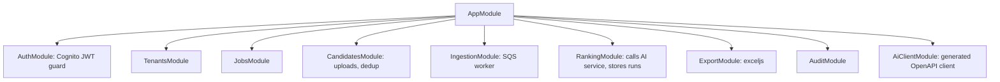

# ADR-004: Backend Framework (Node.js)

| Field | Value |
|---|---|
| Status | 🟡 Proposed |
| Owner | Abdallah |
| Reversal cost | High |

## Context
The application backend handles tenants, users, jobs, candidates, uploads, ranking runs, exports and the audit log. It must grow into the startup product. The team chose **Node.js**.

## Options

| Option | Pros | Cons | Price |
|---|---|---|---|
| **A. NestJS + Prisma** ✅ | Clean modular architecture (like .NET); dependency injection; Guards/Pipes; auto Swagger/OpenAPI; first-class queues (SQS/BullMQ), WebSockets for Phase 2; easy for new hires | More boilerplate/decorators; slightly slower startup (fine on containers) | \$0 |
| B. Fastify + Zod + Drizzle | Very fast; minimal; great TypeScript | We build structure ourselves; less "enterprise" by default | \$0 |
| C. Express | Everyone knows it | Old patterns; manual everything; weak typing | \$0 |
| D. Next.js API routes only (no separate backend) | One app; fewest moving parts | Long-running jobs/queues don't fit; mixes UI and backend; harder to scale separately | \$0 |
| E. Hono | Tiny, runs on Lambda/edge | Young ecosystem for a large product | \$0 |

### ORM sub-decision

| ORM | Pros | Cons |
|---|---|---|
| **Prisma** ✅ | Best DX, migrations, typed client | Raw SQL needed for pgvector/FTS (supported via `$queryRaw`) |
| Drizzle | SQL-like, light, good pgvector support | Younger migrations tooling |
| TypeORM | Classic NestJS pairing | More bugs, weaker types |

## Module structure (if A)

## Recommendation
**Option A: NestJS + Prisma.** The API and the ingestion worker are two entry points of the same codebase, deployed as two ECS services.

## 🗳️ Meeting Decision
- Framework: ☐ NestJS ☐ Fastify ☐ Other
- ORM: ☐ Prisma ☐ Drizzle
