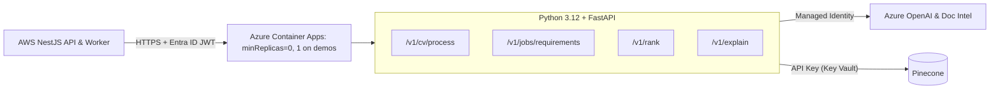

# ADR-005: AI Service Runtime & Hosting

| Field | Value |
|---|---|
| Status | 🟡 Proposed |
| Owner | Karim |
| Reversal cost | Low (container image is portable) |

## Context
Karim's AI logic (parsing, extraction, embeddings, retrieval, scoring, explanations, evaluation) needs a runtime and a host. Python has the best AI/NLP ecosystem. Per ADR-002, it lives on Azure next to Azure OpenAI.

## Runtime options

| Option | Pros | Cons |
|---|---|---|
| **A. Python 3.12 + FastAPI + Pydantic v2** ✅ | Best AI libraries (PyMuPDF, numpy, rank-bm25, Azure SDKs, Pinecone SDK); auto OpenAPI; async; Karim's strength; same code for notebooks and evaluation | Second language in the repo |
| B. TypeScript (all-Node) | One language | Weaker parsing/NLP/eval tooling; Karim less productive |

## Hosting options (on Azure)

| Option | Pros | Cons | Price (prototype) |
|---|---|---|---|
| **A. Azure Container Apps (Consumption)** ✅ | Scale-to-zero; monthly free grant (180k vCPU-s, 360k GiB-s, 2M requests); Managed Identity; built-in auth (Easy Auth); same image runs on ECS | Cold start ~5–15 s after idle (fix with `minReplicas=1` during demos, ≈ \$10–15/month) | **\$0–5** |
| B. Azure Functions (Flex Consumption) | Cheap per call | Awkward for long CV jobs and heavy dependencies; Python cold starts | \$0–5 |
| C. Azure App Service (B1) | Simple, always-on | Pays 24/7; less scalable | ≈ \$13 |
| D. AKS (Kubernetes) | Full control | Big overkill for 2 people | \$70+ |
| E. Host on AWS ECS instead | One less cloud for compute | Loses Managed Identity to Azure OpenAI/DI; keys must cross clouds | \$5–10 |

## API surface (contract v1)

| Endpoint | Purpose | Called by |
|---|---|---|
| `POST /v1/cv/process` | Parse → extract → normalise → embed → upsert; return `CandidateProfile` | Ingestion worker |
| `POST /v1/jobs/requirements` | JD → structured `JobRequirements` (editable) | API |
| `POST /v1/rank` | Filters + weights → ranked list + breakdown + evidence | API |
| `POST /v1/explain` | Pros/cons for one candidate vs one job | API |
| `DELETE /v1/candidates/{id}` | Remove vectors (right to be forgotten) | API |
| `GET /healthz` | Health check | Both |

## Recommendation
**FastAPI on Azure Container Apps**, `minReplicas=0` normally and `1` during demo days. Use **uv** for Python dependencies.

## 🗳️ Meeting Decision
- Runtime: ☐ Python/FastAPI ☐ Other
- Hosting: ☐ Container Apps ☐ Functions ☐ App Service ☐ AWS ECS
