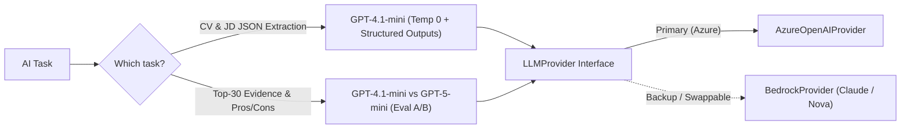

# ADR-006: LLM Provider & Model

| Field | Value |
|---|---|
| Status | 🟡 Proposed |
| Owner | Karim |
| Reversal cost | Low (model name is config; re-run the eval) |

## Context
The LLM is used for: (1) **CV → structured profile** extraction, (2) **JD → structured requirements**, (3) **evidence check** for the Top 30, (4) **pros/cons** on demand. It is **not** used to produce the final score (see ADR-011). We need reliable JSON, low cost, Arabic + English support and enterprise trust.

## Options

| Option | Quality (extraction) | JSON reliability | Price per 1M tokens (in / out) | Cost per 1,000 CVs | Notes |
|---|---|---|---|---|---|
| Azure OpenAI GPT-4.1-nano | Medium | Structured Outputs ✅ | \$0.10 / \$0.40 | ≈ \$0.6 | Good for simple fields only |
| **Azure OpenAI GPT-4.1-mini** ✅ | High | Structured Outputs ✅ | \$0.40 / \$1.60 | **≈ \$2.5** | Best price/quality, fast, 1M context |
| Azure OpenAI GPT-5-mini | High+ | Structured Outputs ✅ | ≈ \$0.25 / \$2.00 (+ reasoning tokens) | ≈ \$3–5 | Reasoning adds latency; good for evidence/pros-cons |
| Azure OpenAI GPT-4.1 | Very high | ✅ | \$2 / \$8 | ≈ \$12 | Use only if mini fails our eval |
| Bedrock Claude Haiku 4.5 | High | Tool-use JSON | ≈ \$1 / \$5 | ≈ \$7 | Backup provider |
| Bedrock Claude Sonnet 4.5 | Very high | Tool-use JSON | ≈ \$3 / \$15 | ≈ \$21 | Premium |
| Bedrock Nova Lite | Medium | JSON mode | ≈ \$0.06 / \$0.24 | ≈ \$0.4 | Very cheap; weaker on Arabic |
| Self-hosted open model (Llama/Qwen) | Medium-high | Needs grammar tooling | GPU ≈ \$400+/month | — | Not worth it at prototype scale |

## Deployment type (Azure)

| Type | Pros | Cons |
|---|---|---|
| **Global Standard** ✅ | Cheapest, highest default quota | Data may be processed in any Azure region (stored at rest in our region) |
| Data Zone Standard (US/EU) | Processing stays inside the zone | ~10% more expensive |
| Provisioned (PTU) | Guaranteed throughput | Hundreds to thousands of USD/month, overkill |

> [!NOTE]
> Azure OpenAI does **not** use customer prompts to train models, an important answer for the company. For EU customers later, switch to **Data Zone EU**.

## Recommendation
- **GPT-4.1-mini** (or the newest *mini* model available in our Foundry region) for extraction and requirements.
- Try **GPT-5-mini** vs GPT-4.1-mini on the evidence step during week 4 and keep whichever wins our eval.
- Temperature 0, Structured Outputs (JSON schema), prompts versioned in Langfuse.
- `LLMProvider` interface with an `AzureOpenAIProvider` (built) and a `BedrockProvider` (stub) as backup.
- **Request Azure OpenAI quota today.** Ask for at least 200k TPM on the mini deployment.

## 🗳️ Meeting Decision
- Extraction model: ☐ 4.1-nano ☐ **4.1-mini** ☐ 5-mini ☐ 4.1
- Deployment type: ☐ Global Standard ☐ Data Zone
- Backup provider: ☐ Bedrock ☐ None for now
