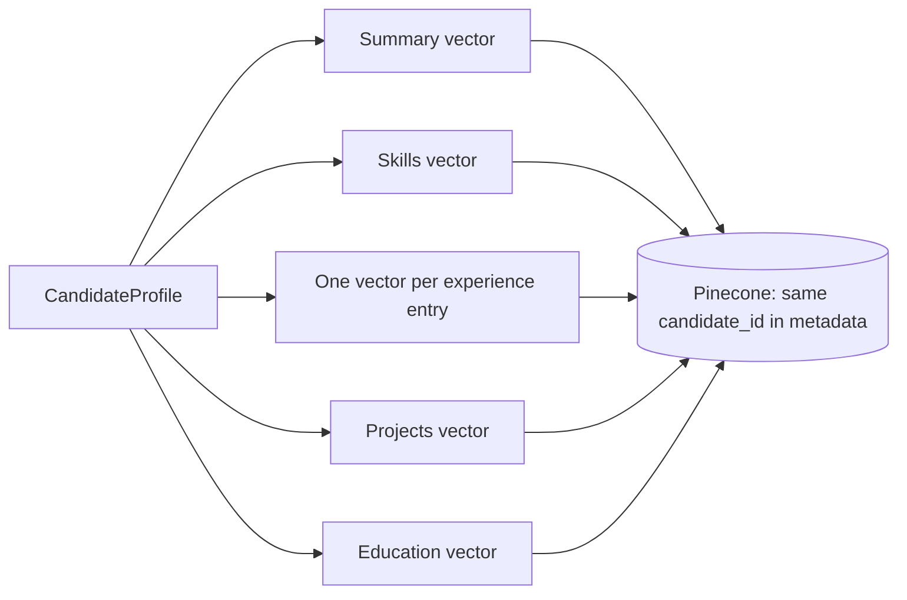

# ADR-007: Embedding Model

| Field | Value |
|---|---|
| Status | 🟡 Proposed |
| Owner | Karim |
| Reversal cost | **Medium-High** (changing model = re-embed every CV and rebuild the index) |

## Context
Embeddings power semantic matching (a JD asking for "backend engineer with cloud experience" should match a CV saying "built microservices on AWS"). They must work in **Arabic + English** and fit Pinecone free storage (2 GB).

## Options

| Model | Dimensions | Multilingual | Price per 1M tokens | Where | Notes |
|---|---|---|---|---|---|
| `text-embedding-3-small` | 1536 (shrinkable) | Good | \$0.02 | Azure OpenAI | Cheapest good option |
| **`text-embedding-3-large`** ✅ | 3072 → **1024** (Matryoshka) | Very good | \$0.13 | Azure OpenAI | Best quality on Azure; truncating to 1024 keeps most quality |
| Cohere Embed v4 / multilingual v3 | 1024 | Excellent (Arabic strong) | ≈ \$0.10–0.12 | Azure Foundry / Bedrock | Strong alternative; test in the spike |
| Titan Text Embeddings v2 | 256–1024 | OK | \$0.02 | Bedrock | Cheaper, weaker |
| Pinecone integrated (`multilingual-e5-large`, `llama-text-embed-v2`) | 1024 | Good | Free 5M tokens/month (Starter) | Pinecone | Couples us to Pinecone |
| Open-source (bge-m3, e5) self-hosted | 1024 | Very good | GPU/CPU hosting cost | Container | More ops |

## What we embed (per CV)

**Storage check:** 1,024 dims × 4 bytes ≈ 4 KB + metadata ≈ 6–8 KB per vector. 6 vectors per CV ≈ 45 KB, so **2 GB fits ≈ 40,000+ CVs**.

**Cost check:** about 2,000 tokens per CV × \$0.13/M ≈ **\$0.0003 per CV** (≈ \$0.26 per 1,000 CVs).

## Recommendation
**`text-embedding-3-large` with `dimensions=1024`**. Run a quick A/B against **Cohere multilingual** in the spike if Arabic CVs are in scope. Store `embedding_model` + `dimensions` on every record so a future re-index is safe.

## 🗳️ Meeting Decision
- Model: ☐ 3-large@1024 ☐ 3-small ☐ Cohere ☐ Other
- Arabic A/B test in spike: ☐ Yes ☐ No
