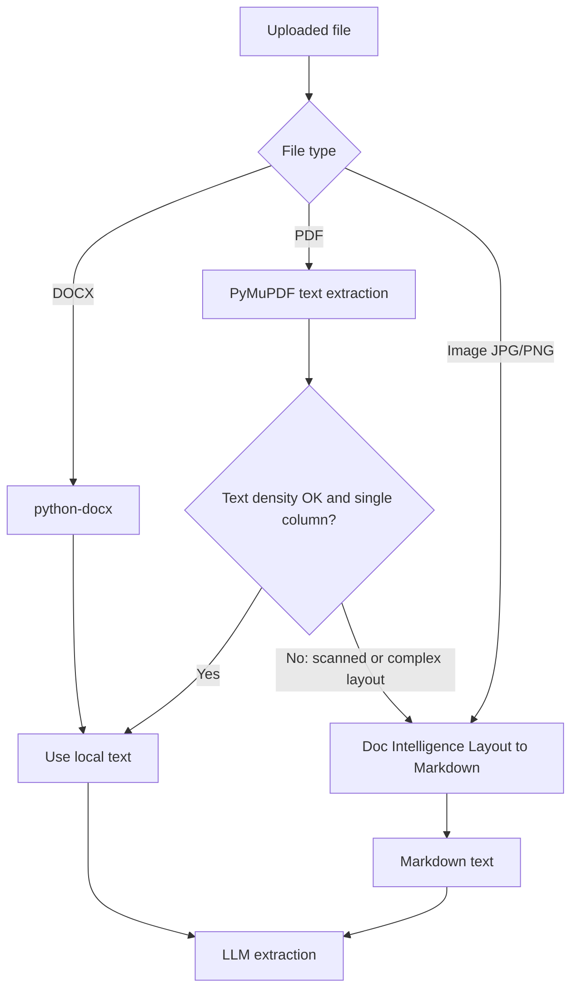

# ADR-008: CV Parsing (PDF / DOCX / Scanned)

| Field | Value |
|---|---|
| Status | 🟡 Proposed |
| Owner | Karim |
| Reversal cost | Low (behind `DocumentParser` interface) |

## Context
CVs come as text PDFs, DOCX, **scanned/image PDFs**, and creative **two-column** layouts. Bad parsing gives bad rankings. Parsing must be cheap at scale.

## Options

| Option | Handles scans | Handles columns/tables | Price | Notes |
|---|---|---|---|---|
| Local libraries (PyMuPDF, pdfplumber, python-docx) | ❌ | Partial | **\$0** | Fast; perfect for clean text CVs |
| **Azure Document Intelligence Layout (S0)** ✅ fallback | ✅ | ✅ Markdown output with headings/tables | ≈ \$10 / 1,000 pages | Output is ideal input for the LLM |
| Azure Document Intelligence Read (S0) | ✅ | Text only | ≈ \$1.50 / 1,000 pages | Cheap OCR when layout doesn't matter |
| Azure Document Intelligence **F0 (free)** | ✅ | ✅ | Free 500 pages/month | ⚠️ **Only first 2 pages of each document**, 4 MB limit: silently cuts CVs |
| AWS Textract (Layout) | ✅ | ✅ | ≈ \$4 / 1,000 pages | Cheaper; output needs more post-processing |
| Send PDF pages as images to a vision LLM | ✅ | ✅ | ≈ \$0.002–0.01 per CV | Simple, but costlier and less predictable |
| Docling / Unstructured (open source) | With OCR add-on | ✅ | \$0 + CPU | Heavier container; good fallback to evaluate |

## Recommended routing

Expected: about 70–85% of CVs are parsed locally for free, and only 15–30% use Document Intelligence.

| Volume | All Layout | Smart routing (~20% Layout) |
|---|---|---|
| 1,000 CVs × 2 pages | \$20 | **≈ \$4** |
| 20,000 CVs | \$400 | **≈ \$80** |

## Other ingestion rules
- Max file size 10 MB; types: PDF, DOCX, DOC (converted), PNG/JPG.
- SHA-256 dedup per job; email + phone dedup per tenant (flag, don't auto-merge).
- Virus scan before processing (later: Amazon GuardDuty Malware Protection for S3, ≈ \$0.09/GB scanned. Prototype: skip or ClamAV container).

## Recommendation
**Local parsers first, Azure Document Intelligence Layout (S0) as fallback.** Do not use F0 for real CVs.

## 🗳️ Meeting Decision
- Decision: ☐ Accept ☐ Doc Intelligence for all ☐ Textract ☐ Vision LLM
- Virus scanning in prototype: ☐ Yes ☐ Later
