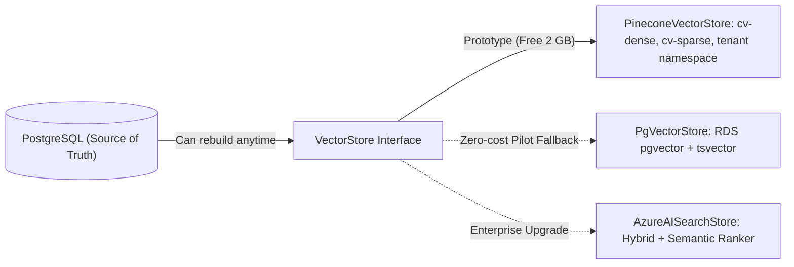

# ADR-009: Vector Database

| Field | Value |
|---|---|
| Status | 🟡 Proposed (team pre-decision: Pinecone free plan) |
| Owner | Karim |
| Reversal cost | Low (Postgres is the source of truth; the index can be rebuilt) |

## Context
We need semantic search over CV sections with **strict metadata filters** (years ≥ X, location, degree), plus keyword (sparse) matching, multi-tenant isolation and a free tier for the prototype.

## Options

| Option | Free tier | Hybrid | Filters | Multi-tenant | Paid price | Verdict |
|---|---|---|---|---|---|---|
| **Pinecone Serverless** ✅ | 2 GB, 1M RU, 2M WU/month, 5 indexes, `us-east-1` only | Dense + sparse indexes | `$eq $in $gte $lte $ne $nin` | Namespaces (up to 100/index on Starter) | Standard **\$50/month minimum** | **Best free fit, fully managed** |
| PostgreSQL + pgvector (in our RDS) | Free inside RDS | With `tsvector` full-text | Full SQL | `tenant_id` + Row-Level Security | \$0 extra | **Best long-term simplicity**; our fallback |
| Azure AI Search | 50 MB, 3 indexes, 1k semantic queries/month | Native hybrid + semantic reranker | ✅ | Index/filter per tenant | Basic ≈ \$74/month, S1 ≈ \$245 | Great product, free tier too small |
| Qdrant Cloud | 1 GB | ✅ | ✅ | Payload filters/collections | ≈ \$25+/month | Good; extra vendor |
| MongoDB Atlas Vector Search | M0 512 MB | ✅ | ✅ | ✅ | M10 ≈ \$57+/month | Only if Mongo were our main DB |
| Weaviate Cloud | Sandbox (14 days) | ✅ | ✅ | ✅ | ≈ \$25+/month | Sandbox expires |

## Trade-offs: Pinecone vs pgvector

| | Pinecone | pgvector |
|---|---|---|
| Ops effort | None | Index tuning (HNSW), vacuum, memory |
| Prototype cost | \$0 | \$0 (inside RDS) |
| Pilot cost | \$50/month minimum | \$0–30 (bigger RDS) |
| Joins with relational data | No (metadata copy) | Yes (single SQL query) |
| Scale beyond millions of vectors | Easy | Needs care |
| Story for investors | "Managed, serverless vector DB" | "Lean, one database" |
| Extra vendor + DPA (data processing agreement) | Yes | No |

## Index design (Pinecone)

| Item | Value |
|---|---|
| Indexes | `cv-dense` (1024-d, cosine) + `cv-sparse` (sparse, for keywords) |
| Namespace | `tenant_<id>` |
| Record ID | `<candidate_id>#<section>#<n>` |
| Metadata | `candidate_id, job_ids[], section, years_exp, seniority, degree_level, field_of_study, country, city, skills[] (canonical ids), embedding_model` |

> [!WARNING]
> Starter limits to remember: **AWS `us-east-1` only**, 2 GB, **500 rerank requests/month** (we don't use Pinecone rerank), 1 GB egress/month, 2 users per org. Projects can be paused after long inactivity, so keep a re-index script ready.

## Recommendation
**Pinecone Starter for the prototype**, behind a `VectorStore` interface, with a `PgVectorStore` adapter written in week 5 (half a day of work). Decide at pilot time: pay Pinecone \$50+/month or move to pgvector. **Never store anything only in Pinecone.**

## 🗳️ Meeting Decision
- Decision: ☐ Pinecone (+pgvector fallback) ☐ pgvector only ☐ Azure AI Search ☐ Qdrant
