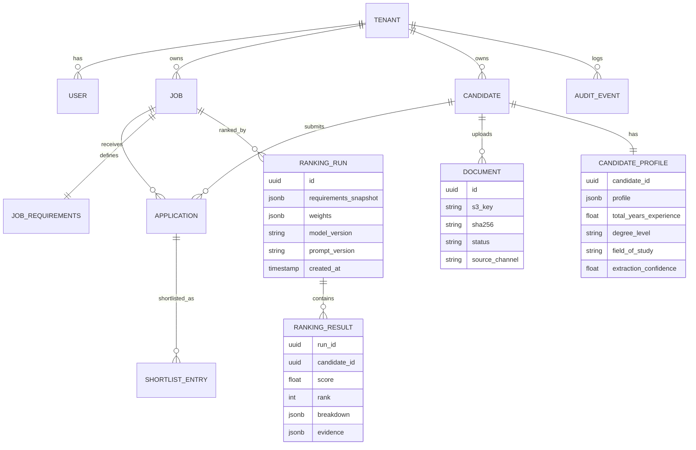

# ADR-010: Primary Database

| Field | Value |
|---|---|
| Status | 🟡 Proposed |
| Owner | Abdallah |
| Reversal cost | Medium |

## Context
The source of truth for tenants, users, jobs, candidates, profiles (JSON), ranking runs (audit) and shortlists. Relational data with some JSON documents. It must be cheap for the prototype and production-grade later.

## Engine options

| Engine | Pros | Cons |
|---|---|---|
| **PostgreSQL 16** ✅ | Relational + JSONB + full-text + pgvector in one; open source; same on AWS/Azure | — |
| MySQL | Familiar | Weaker JSON/vector story |
| MongoDB | Flexible documents | Weak for relational reporting; another paradigm |
| SQL Server | Original spec choice | Licence cost; tied to .NET plan we dropped |

## Hosting options

| Option | Price (prototype) | Pros | Cons |
|---|---|---|---|
| **AWS RDS PostgreSQL `db.t4g.micro`, 20 GB gp3, single-AZ** ✅ | **≈ \$14/month** | Same cloud/VPC as the API; automated backups; easy upgrade path | Always-on cost |
| Aurora Serverless v2 (scale to 0) | ≈ \$0–10 idle + \$0.12/ACU-hour | Pauses when idle | ~15 s cold start: bad in a live demo |
| Neon (serverless Postgres, on AWS) | \$0 (free tier 0.5 GB) | Branching per PR, scale-to-zero | Extra vendor; small free storage |
| Supabase | \$0 (500 MB; pauses after 7 days idle) | Auth/storage included | Overlaps with our stack; pausing |
| Azure Database for PostgreSQL B1ms | ≈ \$13–15/month | If we move the app to Azure | Cross-cloud from the API |

## Core data model (draft)

## Recommendation
**PostgreSQL 16 on RDS `db.t4g.micro`**, single-AZ, 7-day backups, encryption on, in a private subnet. Turn on the `pgvector` extension from day 1 (free fallback for ADR-009). Use **local Postgres in Docker** for development.

## 🗳️ Meeting Decision
- Decision: ☐ RDS t4g.micro ☐ Aurora Serverless v2 ☐ Neon ☐ Other
