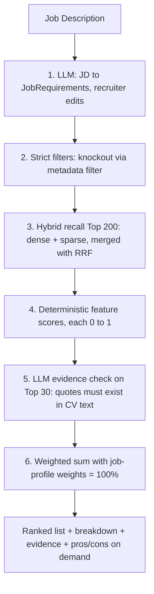

# ADR-011: Ranking & Scoring Method (Core of the Product)

| Field | Value |
|---|---|
| Status | 🟡 Proposed |
| Owner | Karim (formula) · Abdallah (UI for weights/filters) |
| Reversal cost | Low technically, **high for trust** (keep it stable once shown to the company) |

## Context
The company will judge us mostly on **whether the Top 10 is right and explainable**. The ranking must be accurate, fast, cheap, **reproducible** (same input gives the same output) and **defensible** (a recruiter can explain it).

## Options

| Option | Accuracy | Explainable | Reproducible | Cost per ranking run (1,000 CVs) | Verdict |
|---|---|---|---|---|---|
| A. Keyword match only (BM25) | Low-medium | Yes | Yes | ≈ \$0 | Baseline only |
| B. Embedding similarity only | Medium | Weak ("similar") | Yes | ≈ \$0 | Not defensible |
| C. LLM scores every CV (0–100) | Medium-high | Text only | ❌ varies run to run | ≈ \$2–5 and slow | Expensive, not auditable |
| **D. Hybrid recall → deterministic weighted features → LLM evidence on Top 30** ✅ | High | ✅ Breakdown + quotes | ✅ | ≈ \$0.05 | **Recommended** |
| E. Learning-to-rank model (trained) | Highest (with data) | Medium | ✅ | ≈ \$0 | Needs labelled data → Phase 2/after pilot |

## Pipeline (Option D)



## Scoring formula

$$
\text{Score} = 100 \times \sum_i w_i \, s_i,\qquad \sum_i w_i = 1,\quad s_i \in [0,1]
$$

| Sub-score | Definition |
|---|---|
| `s_skills` | Weighted coverage of required skills on **canonical IDs** (must-have = 1.0, nice-to-have = 0.5). Counts only when backed by verified evidence in step 5. |
| `s_semantic` | Normalised similarity of JD vs best CV sections (mean of top-3 section scores) |
| `s_experience` | `min(1, years / required_years)`, optional mild penalty if far over-qualified |
| `s_education` | Degree-level ordering + field-of-study similarity |
| `s_location` | 1 same city · 0.5 same country / remote OK · 0 otherwise |
| `s_soft` | Share of "preferred" (soft) filters met |

## Default job-profile weights (%)

| Profile | Skills | Semantic | Experience | Education | Location | Soft |
|---|---|---|---|---|---|---|
| Junior | 30 | 20 | 10 | 25 | 10 | 5 |
| Mid | 35 | 25 | 20 | 10 | 5 | 5 |
| Senior | 35 | 20 | 30 | 5 | 5 | 5 |
| Manager | 25 | 25 | 35 | 5 | 5 | 5 |

Recruiters can change the weights with sliders. The UI enforces a total of 100%.

## Strict vs soft filters

| Filter type | Behaviour | Example |
|---|---|---|
| **Strict** | Candidate is excluded if it fails | "Min 3 years", "Must be in Egypt", "Bachelor or higher" |
| **Soft** | Adds to `s_soft`, never excludes | "Prefer AWS certification", "Prefer Cairo" |

> [!WARNING]
> Strict filters can wrongly exclude good candidates when extraction is uncertain (e.g. years of experience unclear). Rule: if `extraction_confidence < 0.7` for that field, **don't exclude**. Flag "needs review" instead.

## Keyword (sparse) choice (depends on CV language)

| Option | English | Arabic | Infra |
|---|---|---|---|
| Pinecone `pinecone-sparse-english-v0` | ✅ | ❌ | None |
| BM25 computed in AI service (Arabic-aware tokeniser) | ✅ | ✅ | Small |
| PostgreSQL full-text | ✅ | Partial | Needs Postgres access (breaks the stateless rule) |

## Explanation example (what the recruiter sees)

```text
#1  Sara M.  — 87/100
  Skills       33/35  ✔ Node.js  "Built REST APIs in Node.js serving 2M users"
                      ✔ PostgreSQL "Designed PostgreSQL schemas for billing"
                      ✖ Kubernetes (nice-to-have, not found)
  Experience   20/20  5.5 years (required 4)
  Semantic     21/25  Strong match on backend + cloud experience
  Education     8/10  BSc Computer Engineering
  Location      5/5   Cairo
```

## Recommendation
**Option D.** Keep the LLM out of the final number. Add Option E (learning-to-rank) after the pilot, once real recruiter feedback exists.

## 🗳️ Meeting Decision
- Method: ☐ D (recommended) ☐ Other
- Default weights: ☐ Accept ☐ Change: \_\_\_\_\_\_
- Sparse/keyword: ☐ Pinecone English ☐ Own BM25 (Arabic) ☐ Skip for prototype
- Evidence Top-N: ☐ 30 ☐ 20 ☐ 50
