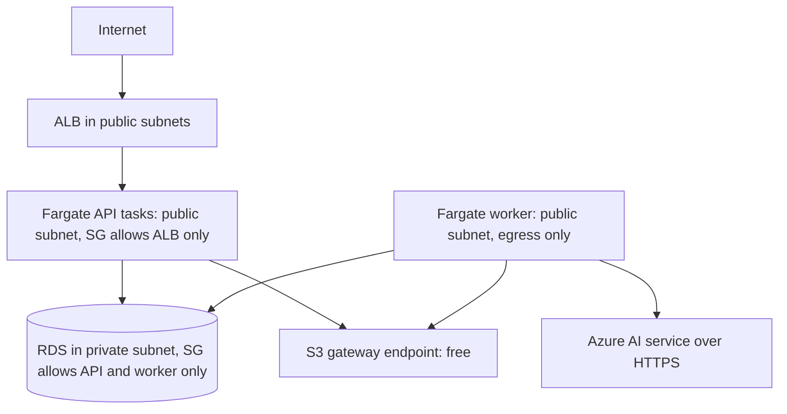

# ADR-012: AWS Compute & Hosting

| Field | Value |
|---|---|
| Status | 🟡 Proposed |
| Owner | Abdallah |
| Reversal cost | Low-Medium (containers are portable) |

## Context
We need to host: (1) the **Next.js frontend**, (2) the **NestJS API**, (3) the **ingestion worker** (SQS consumer). Fixed infrastructure is the **largest prototype cost**, so this decision matters for the budget.

## Frontend hosting

| Option | Price | Pros | Cons |
|---|---|---|---|
| **AWS Amplify Hosting** ✅ | ≈ \$1–3/month | Next.js SSR supported; PR previews; custom domain + TLS; stays in AWS | Next.js features sometimes lag behind Vercel |
| S3 + CloudFront (static export) | ≈ \$1 | Cheapest, simplest | No SSR (fine if we go Vite SPA) |
| Vercel | Hobby free (**non-commercial only**), Pro \$20/user | Best Next.js support | Outside AWS; commercial use needs Pro |
| ECS container with Next.js | Part of Fargate cost | Full control | We manage CDN/caching |

## API + worker compute

| Option | Monthly (prototype) | Pros | Cons |
|---|---|---|---|
| **A. ECS Fargate + ALB** ✅ | Fargate ≈ \$9 (API) + ≈ \$3 (worker, Spot) + ALB ≈ \$18 ≈ **\$30** | Standard container platform; no servers; scales; same image anywhere; good investor story | ALB fixed cost |
| B. ECS Fargate, no ALB (public IP + Cloudflare/CloudFront in front) | ≈ \$15 | Saves \$18 | No health-based routing; IP changes on deploy (needs workaround) |
| C. Lambda + API Gateway (NestJS via adapter) | ≈ \$0–2 | Near-free; scales to zero | Cold starts; 29 s API Gateway timeout; long jobs need a separate worker; less natural for NestJS |
| D. EC2 `t4g.small` + Docker Compose | ≈ \$12 | Cheapest always-on | We manage the server, patching, scaling: bad story |
| E. Lightsail containers | ≈ \$7–10 | Simple, cheap | Limited networking/IAM integration |
| F. EKS (Kubernetes) | ≈ \$73 control plane + nodes | Industry standard at scale | Overkill for 2 people |

## Network layout (no NAT Gateway: saves ≈ \$33/month)

> Fargate tasks in public subnets with a public IP (≈ \$3.65/month each) cost less than a NAT Gateway (≈ \$33+/month). Security groups block all inbound traffic except from the ALB.

## Recommendation
**Amplify Hosting** for Next.js + **ECS Fargate (ARM/Graviton) + ALB** for the API, plus a **Fargate Spot** worker. No NAT Gateway. If budget is tight, choose Option B or C and save about \$18–28/month.

## 🗳️ Meeting Decision
- Frontend: ☐ Amplify ☐ S3+CloudFront ☐ Vercel
- API: ☐ Fargate + ALB ☐ Fargate no ALB ☐ Lambda ☐ EC2
