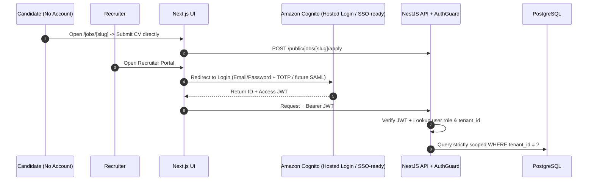

# ADR-013: Authentication

| Field | Value |
|---|---|
| Status | 🟡 Proposed |
| Owner | Abdallah |
| Reversal cost | Medium (user migration) |

## Context
Recruiters log in. Candidates **do not** need accounts (public apply link). Enterprise customers will later ask for **SSO (SAML/OIDC)** with their Microsoft Entra ID / Okta, plus multi-tenancy (users belong to a company).

## Options

| Option | Free tier | Enterprise SSO | Pros | Cons |
|---|---|---|---|---|
| **Amazon Cognito** ✅ | 10,000 MAU free (Lite/Essentials) | ✅ SAML/OIDC (paid per MAU above free tier) | Same cloud; Terraform-friendly; hosted login (Managed Login); JWT verified in NestJS | UI customisation limited; quirky docs |
| Microsoft Entra External ID | 50,000 MAU free | ✅ Excellent with Microsoft customers | Great for Microsoft-heavy enterprises | Lives in Azure (app is on AWS) |
| Clerk | 10,000 users free | ✅ (paid) | Best developer experience, ready UI | Third-party vendor; data outside our cloud |
| Auth0 | 25,000 MAU free (B2C) | ✅ (B2B plans ≈ \$150+/month) | Mature | Gets expensive fast |
| Roll our own (Passport + JWT) | \$0 | ❌ by default | Full control | Security risk; time sink |

## Tenancy model

- `tenant_id` lives in our database; Cognito user → `user` row → `tenant_id`.
- Roles: `owner`, `recruiter`, `viewer` (checked by NestJS guards).
- Demo: one seeded tenant "Demo Corp" + invite-only sign-up.

## Recommendation
**Amazon Cognito** with Managed Login, email + password + optional TOTP MFA. Add SAML federation when the first enterprise asks.

## 🗳️ Meeting Decision
- Decision: ☐ Cognito ☐ Entra External ID ☐ Clerk ☐ Auth0
- Self sign-up in demo: ☐ Yes ☐ Invite-only
