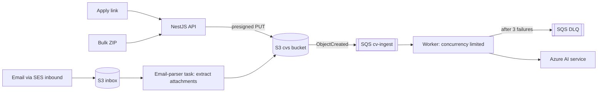

# ADR-014: CV Ingestion Channels & Queue

| Field | Value |
|---|---|
| Status | 🟡 Proposed |
| Owner | Karim (Team Lead, AI processing) · Abdallah (channels, queue) |
| Reversal cost | Low |

## Context
"Aggregation" is half of the pitch: CVs arrive from **many places** and end up in one ranked list. Bulk uploads (hundreds of CVs at once) must not block the UI and must survive failures.

## Channel options

| Channel | Value in demo | Effort | Cost | Recommend |
|---|---|---|---|---|
| **Public job apply link** (`/jobs/<slug>`) | High: the candidate experience | Low | \$0 | ✅ Must |
| **Bulk upload** (multi-file / ZIP) | High: "drop 500 CVs" moment | Low-Med | \$0 | ✅ Must |
| **Email forwarding** (`jobs+<jobId>@ourdomain`) via SES inbound | **Very high**: "forward your inbox" | Medium | ≈ \$0.10 per 1,000 emails | ✅ Should |
| Google Forms webhook (Apps Script) | Medium | Low | \$0 | ⚪ Could |
| Shared Google Drive / OneDrive folder sync | Medium | Medium-High (OAuth) | \$0 | ⚪ Later |
| ATS import (Greenhouse/Workday API) | High for enterprise | High | Varies | ⚪ Later |
| LinkedIn Easy Apply (official API vs email/ATS workaround) | See [ADR-020](020-external-connectors-and-linkedin.md) | Low–High | \$0–Varies | ✅ Email intake now; ATS/Partner API later |
| LinkedIn scraping | — | — | — | ❌ Breaks LinkedIn's terms |

## Queue options

| Option | Price | Pros | Cons |
|---|---|---|---|
| **Amazon SQS + DLQ** ✅ | First 1M requests/month free | Serverless; native S3 event trigger; retries + DLQ; zero ops | AWS-specific (adapter for Service Bus later) |
| BullMQ + Redis (ElastiCache) | ≈ \$12+/month for Redis | Rich features (cron, priorities) | Another server to run; costs money |
| Azure Service Bus | ≈ \$0.05 per 1M operations (Basic) | Good | Cross-cloud for the AWS side |
| EventBridge | \$1 per 1M events | Event routing | Not a work queue |

## Flow

## Reliability rules
- **Idempotency key:** `sha256(file) + job_id`, so re-processing never creates duplicates.
- **Visibility timeout** 2 min; **max receives** 3 → DLQ; UI shows failed items with a "retry" button.
- **Back-pressure:** worker concurrency (e.g. 5) sized to the Azure OpenAI TPM quota.
- **Status machine:** `RECEIVED → PARSING → EXTRACTING → INDEXED` or `FAILED` (shown live in the UI with polling/SSE).

## Recommendation
Apply link + bulk upload + **email forwarding** via **S3 → SQS → Fargate worker**.

## 🗳️ Meeting Decision
- Channels in demo: ☐ Apply link ☐ Bulk ☐ Email ☐ Google Forms
- Queue: ☐ SQS ☐ BullMQ ☐ Service Bus
