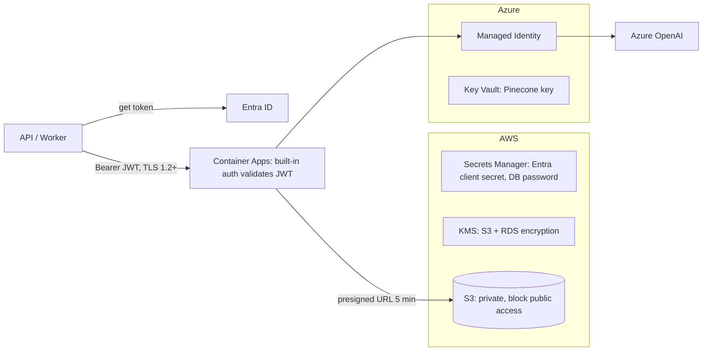

# ADR-015: Cross-Cloud Security & Networking

| Field | Value |
|---|---|
| Status | 🟡 Proposed |
| Owner | Abdallah (with Karim) |
| Reversal cost | Low |

## Context
AWS services call the Azure AI service, and the Azure AI service reads CV files from S3. CVs are personal data. We want **no long-lived keys where avoidable**, encryption everywhere, and a setup simple enough for 2 people.

## AWS → Azure (calling the AI service)

| Option | Security | Effort | Cost |
|---|---|---|---|
| Static API key in header | Weak (key leaks = full access) | Very low | \$0 |
| **OAuth2 client credentials (Entra ID app) + Container Apps built-in auth** ✅ | Good: short-lived JWTs, secret stored in AWS Secrets Manager, rotated | Low | \$0 |
| Workload identity federation (AWS role → Entra ID, no secret) | Best | Medium-High | \$0 |
| Azure API Management in front (Consumption) | Good + rate limits, analytics | Medium | ≈ \$0 for first 1M calls, then ≈ \$3.50/M |
| Site-to-site VPN + private endpoints | Best network isolation | High | ≈ \$70–150/month (VPN gateways both sides) |

## Azure → files in S3

| Option | Notes |
|---|---|
| **Presigned GET URL per request (5-minute expiry)** ✅ | No AWS credentials in Azure; access limited to one object |
| IAM user keys stored in Azure Key Vault | Long-lived keys crossing clouds ❌ |
| Copy file content in the request body | Simple, but bigger payloads; fine for small files as a fallback |

## Azure → Azure OpenAI / Document Intelligence
**Managed Identity** (no keys at all), role `Cognitive Services OpenAI User`.

## Security baseline (prototype)

| Control | Setting |
|---|---|
| Encryption at rest | S3 SSE-KMS, RDS encrypted, Azure defaults |
| Encryption in transit | TLS 1.2+ everywhere |
| Secrets | AWS Secrets Manager + Azure Key Vault; never in Git; `gitleaks` in CI |
| IAM | Least privilege per ECS task role; no wildcard `*` actions |
| CI/CD credentials | GitHub OIDC → AWS role + Azure federated credential (no stored keys) |
| Logging | No CV text or PII in logs; IDs only |
| Ingress | Container Apps ingress restricted to AWS egress IPs (optional) + JWT |
| Dependency scanning | Dependabot + `npm audit` / `pip-audit` in CI |

## Recommendation
OAuth2 client credentials + presigned URLs + Managed Identity now. Move to workload identity federation + API Management at pilot. Add VPN/private links only if a customer requires it.

## 🗳️ Meeting Decision
- Decision: ☐ Accept ☐ Start with API key (faster, weaker) ☐ Go straight to federation
