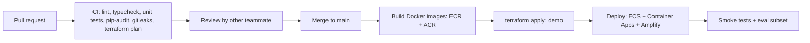

# ADR-016: IaC, CI/CD & Repository Structure

| Field | Value |
|---|---|
| Status | 🟡 Proposed |
| Owner | Abdallah |
| Reversal cost | Medium |

## Context
Two clouds, two languages, two people. Everything must be reproducible (no clicking in consoles), deployable in minutes, and impressive to a technical due-diligence review.

## Infrastructure as Code

| Option | Multi-cloud | Pros | Cons | Price |
|---|---|---|---|---|
| **Terraform (or OpenTofu)** ✅ | ✅ one tool for AWS + Azure | Industry standard; huge module ecosystem; DevOps CV value | HCL language | \$0 (state in S3 with native locking) |
| Pulumi (TypeScript) | ✅ | Real programming language | Smaller community; state service | Free tier |
| AWS CDK + Bicep | ❌ two tools | Native per cloud | Two languages, two workflows | \$0 |
| Click-ops | — | Fast on day 1 | Not reproducible: red flag | \$0 |

**State:** S3 bucket with versioning + native S3 state locking (`use_lockfile = true`), or HCP Terraform free (≤ 500 resources).

```text
infra/terraform/
├── modules/  (network, rds, ecs-service, s3-bucket, container-app, openai, ...)
├── aws/      (demo environment, AWS resources)
└── azure/    (demo environment, Azure resources)
```

## CI/CD

| Option | Price | Notes |
|---|---|---|
| **GitHub Actions** ✅ | 2,000 free min/month (private), unlimited (public) | OIDC to AWS **and** Azure, no stored keys |
| GitLab CI | 400 free min | Fine, but GitHub is more common |
| AWS CodePipeline / Azure DevOps | Low | Locks CI to one cloud |



## Repository

| Option | Pros | Cons |
|---|---|---|
| **Monorepo (Turborepo + pnpm, uv for Python)** ✅ | One PR changes contract + API + AI together; shared types; single CI | Mixed languages need care |
| Polyrepo (3 repos) | Clear isolation | Contract drift; 3× CI setup; slower for 2 people |

**Contract sync:** FastAPI generates `openapi.json` → CI generates a TypeScript client into `packages/shared` → the NestJS build fails if the contract breaks.

**Git workflow:** trunk-based, short-lived branches, squash-merge, Conventional Commits, branch protection on `main`.

## Container registry
ECR (AWS, ≈ \$0.10/GB) for API/worker; ACR Basic (Azure, ≈ \$5/month) or ECR pulled cross-cloud for the AI service. Recommendation: **ACR Basic** so Container Apps can pull with Managed Identity.

## Recommendation
Terraform + GitHub Actions (OIDC) + monorepo (Turborepo/pnpm + uv) + trunk-based workflow.

## 🗳️ Meeting Decision
- IaC: ☐ Terraform ☐ OpenTofu ☐ Pulumi
- Repo: ☐ Monorepo ☐ Polyrepo
- Public or private repo: ☐ Private (recommended until pitch) ☐ Public
