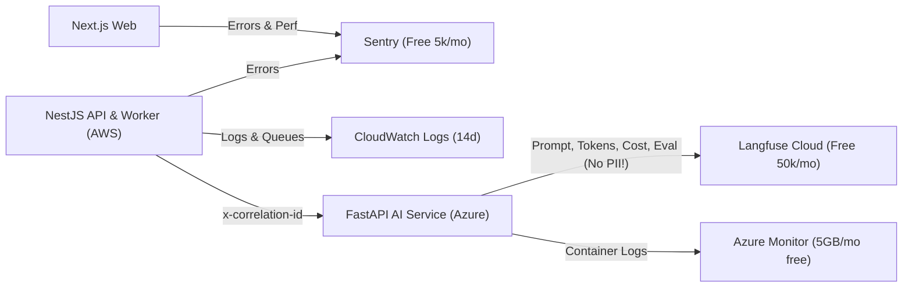

# ADR-017: Observability & LLMOps

| Field | Value |
|---|---|
| Status | 🟡 Proposed |
| Owner | Karim (LLM tracing) · Abdallah (app monitoring) |
| Reversal cost | Low |

## Context
We must see: errors, latency, cost per CV, which prompt version produced which result, and why a ranking looks wrong. LLM behaviour needs special tracing (prompt, response, tokens, cost).

## Options

| Need | Option | Price | Recommend |
|---|---|---|---|
| LLM tracing, prompt versions, eval scores | **Langfuse Cloud** | Hobby free (50k units/month); Core ≈ \$29 | ✅ |
| | LangSmith | Free 5k traces/month | ⚪ |
| | Azure AI Foundry tracing | Included | ⚪ Later |
| App errors | **Sentry** | Free 5k errors/month | ✅ |
| Logs & metrics (AWS) | **CloudWatch** | ≈ \$0.50/GB logs | ✅ (14-day retention) |
| Logs & metrics (Azure) | **Azure Monitor / Log Analytics** | First 5 GB/month free | ✅ |
| Unified traces across clouds | OpenTelemetry → Grafana Cloud | Free tier (50 GB logs/traces) | ⚪ Pilot |
| Uptime | Better Stack / UptimeRobot | Free | ✅ |

## Key metrics dashboard

| Metric | Why |
|---|---|
| CVs processed / min, queue depth, DLQ count | Ingestion health |
| Parse success rate, % routed to Doc Intelligence | Parsing quality and cost |
| Tokens + USD per CV, per ranking run | Unit economics (pitch slide) |
| p50 / p95 ranking latency | UX |
| Extraction confidence distribution | Data quality |
| NDCG@10 per prompt/model version | AI quality over time |

> [!CAUTION]
> Langfuse traces contain prompts. **Send the anonymised CV text only** (no name, email or phone), or self-host Langfuse later.

## Recommendation
Langfuse + Sentry + native cloud logs, with OpenTelemetry instrumentation from day 1 so we can move to Grafana later without code changes.

## 🗳️ Meeting Decision
- Decision: ☐ Accept ☐ Change: \_\_\_\_\_\_
