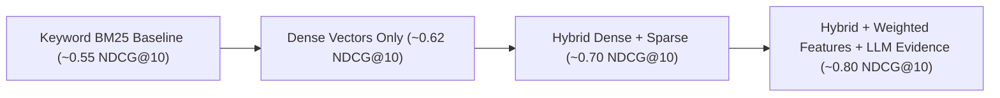

# ADR-018: Evaluation Strategy (How We Prove Ranking Quality)

| Field | Value |
|---|---|
| Status | 🟡 Proposed |
| Owner | Karim |
| Reversal cost | Low |

## Context
"Our AI ranks CVs well" is just a claim. **"Our Top 10 matches HR experts' choices 0.82 NDCG vs 0.61 for keyword search"** is evidence. Large companies make decisions on evidence. This is the most important slide of the pitch.

## Dataset options

| Source | Pros | Cons | Cost |
|---|---|---|---|
| **Partner company's anonymised CVs + JDs** | Most convincing; real distribution | Needs NDA/data agreement; may take time | \$0 |
| Public resume datasets (e.g. Kaggle resume datasets) | Available now; hundreds–thousands of CVs | Check licences; often English only, old, categorised loosely | \$0 |
| **Synthetic CVs generated by LLM** | Full control; known ground truth; Arabic possible; no privacy issues | May be "too clean"; must be mixed with real ones | ≈ \$1–5 |
| Our own network's CVs (with consent) | Real, local (Egypt/MENA) | Small; consent forms needed | \$0 |

**Recommendation:** about 500 CVs (≈ 60% public/real, ≈ 40% synthetic with deliberate hard cases: career changers, two-column layouts, Arabic, scanned) × 5–8 JDs across junior/mid/senior/manager.

## Labelling

| Option | Pros | Cons |
|---|---|---|
| **2–3 HR reviewers grade 0–3 relevance in our labelling UI** ✅ | Credible; measures agreement between reviewers | Takes reviewer time (~4–6 h each) |
| LLM-as-judge labels | Fast, cheap | Circular (AI grading AI); use only as a supplement |
| Team labels | Fast | Not credible to the company |

Grades: 0 = not relevant, 1 = weak, 2 = good, 3 = excellent. Label only the pooled Top 30 from all methods per JD (standard "pooling" to save effort).

## Metrics

| Metric | Meaning | Target |
|---|---|---|
| **NDCG@10** | Is the Top 10 in the right order? | ≥ 15% better than keyword baseline |
| Precision@10 | Share of the Top 10 that are good (grade ≥ 2) | ≥ 0.7 |
| MRR | How high is the first excellent candidate? | ≥ 0.8 |
| Recall@50 | Do good candidates survive filtering? | ≥ 0.9 |
| Extraction field accuracy | Profile correctness vs manual check on 50 CVs | ≥ 90% |
| **Fairness swap test** | Same CV, different name/gender → score difference | ≤ 1 point |
| Reviewer agreement (Cohen's kappa) | Are the labels themselves consistent? | ≥ 0.6 |

## Experiments to show

> [!WARNING]
> The numbers in the chart are **illustrative targets**, not results. Only present measured numbers to the company.

## Tooling
- `eval/` folder: datasets, labels (CSV/JSON), `make eval` runs all methods and prints metrics.
- Results logged per **model + prompt + weights version** in Langfuse.
- A subset (50 CVs, 2 JDs) runs in CI on every prompt/model change as a regression guard.

## 🗳️ Meeting Decision
- Dataset: ☐ Company data ☐ Public + synthetic ☐ Both
- Labellers: \_\_\_\_\_\_ (names / how many)
- Targets accepted: ☐ Yes ☐ Change: \_\_\_\_\_\_
