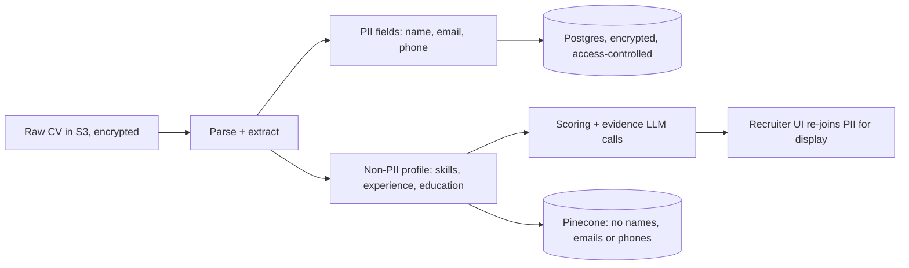

# ADR-019: Privacy, Compliance & Fairness

| Field | Value |
|---|---|
| Status | 🟡 Proposed |
| Owner | Both |
| Reversal cost | High if ignored (adding it later is painful) |

## Context
CVs contain personal data (name, contact, sometimes age, photo, nationality, religion). AI-assisted hiring is legally sensitive:
- **EU AI Act:** recruitment/candidate-ranking AI is classified as **high-risk**. It needs risk management, data governance, logging, transparency, human oversight and accuracy measures.
- **GDPR (EU) / Egypt PDPL (Law 151/2020) / Saudi PDPL / UAE PDPL:** lawful basis, consent/notice, retention limits, right to access/delete, cross-border transfer rules.
- **NYC Local Law 144 (if US customers):** bias audits for automated hiring tools.

Large companies run vendor security/privacy reviews. Showing these controls in a prototype is a strong selling point.

## Controls: what we build now vs later

| Control | Prototype | Pilot / Production |
|---|---|---|
| **Blind scoring**: remove name, gender, age, photo, nationality, marital status, religion before LLM scoring | ✅ | ✅ |
| **Human-in-the-loop**: AI suggests, recruiter decides; no automatic rejection emails | ✅ | ✅ |
| **Explainability**: score breakdown + evidence quotes | ✅ | ✅ |
| **Audit log**: `ranking_run` stores requirements, weights, model + prompt versions, all scores | ✅ | ✅ + export |
| **Fairness swap test** in evaluation | ✅ | Regular bias audits |
| Candidate **privacy notice + consent checkbox** on apply page | ✅ | ✅ + per-tenant text |
| **Retention**: auto-delete CVs after N days (default 180) via S3 lifecycle + DB job | ✅ (configurable) | Per-tenant policy |
| **Right to delete**: cascade S3 + Postgres + Pinecone | ✅ | DSAR tooling |
| Encryption at rest + in transit | ✅ | ✅ + customer-managed keys |
| No PII in logs / traces | ✅ | ✅ |
| Data Processing Agreements (Azure, AWS, Pinecone, Langfuse) | Review | Signed |
| Data residency (EU / ME regions) | ⏸️ | ✅ |
| Penetration test, SOC 2 / ISO 27001 roadmap | ⏸️ | ✅ |

## Data flow & PII boundary

> [!IMPORTANT]
> **Pinecone metadata and Langfuse traces must never contain names, emails or phone numbers.** Use `candidate_id` only.

## Recommendation
Build all ✅ prototype controls (about 2–3 days of total effort). Put a **"Responsible AI & Privacy"** slide in the pitch.

## 🗳️ Meeting Decision
- Default retention: ☐ 90 ☐ 180 ☐ 365 days
- Blind scoring in prototype: ☐ Yes ☐ No
- Who reviews vendor DPAs: \_\_\_\_\_\_
