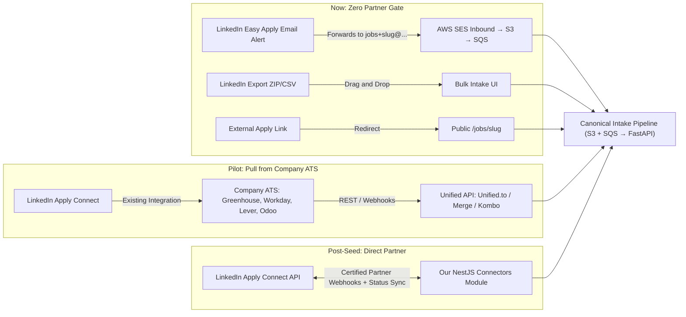
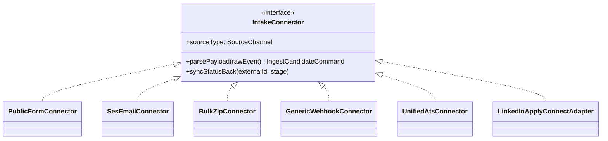

# ADR-020: External Connectors & LinkedIn Easy Apply Strategy

| Field | Value |
|---|---|
| Status | 🟡 Proposed |
| Owner | Karim (Team Lead, payload normalization) · Abdallah (connectors & webhooks) |
| Reversal cost | Low (all connectors normalize into the same `IngestSource` pipeline) |

## Context
The partner company specifically asked whether our platform can connect to **LinkedIn Easy Apply** and aggregate CVs from external channels. We must separate what is **technically possible and legal in a 6-week prototype** from what requires **enterprise partner approvals** (after funding).

> [!CAUTION]
> **Never use LinkedIn scraping or browser automation.** Logging into LinkedIn with Playwright/Puppeteer or buying scraped data violates LinkedIn's Terms of Service, risks banning the company's corporate LinkedIn Recruiter accounts, and fails enterprise security/legal due diligence immediately.

---

## 1. LinkedIn Easy Apply: How Connections Actually Work

There are **4 legitimate paths** for LinkedIn Easy Apply, ranging from 0-day prototype solutions to enterprise partner APIs:

| Path | How it works | Partner approval needed? | Cost | Time to build | Verdict |
|---|---|---|---|---|---|
| **A. LinkedIn "Receive Applicants by Email" → SES Inbound** ✅ | When posting a job on LinkedIn without an ATS, recruiters set the notification email to our job address (`jobs+<slug>@intake.ourdomain`). Every Easy Apply submission sends the candidate's attached CV + screening answers straight into our S3/SQS pipeline. | ❌ None | ≈ \$0.10 / 1k emails | 2–3 days | **Best for Prototype** |
| **B. LinkedIn Applicant Export (CSV + Resumes ZIP)** ✅ | Recruiter downloads candidates/resumes from LinkedIn Jobs dashboard and drops them into our Bulk Uploader (optional CSV mapper extracts profile links & answers). | ❌ None | \$0 | 1 day | **Must-have Demo Fallback** |
| **C. Indirect via Company's Existing ATS (Unified API)** ✅ | Large companies *already* link LinkedIn Easy Apply to their ATS (Workday, Greenhouse, Lever, SAP SuccessFactors, BambooHR). We plug into their **ATS** via a Unified API (**Unified.to / Merge.dev / Kombo**) and pull all LinkedIn Easy Apply candidates automatically. | ❌ None for us (uses customer's ATS creds) | \$0 test / \$650–750/mo prod | 3–5 days (Pilot) | **Best Pilot Strategy** |
| **D. Direct LinkedIn Apply Connect API (Official)** | Native LinkedIn Talent Solutions integration: bidirectional job publish (`CREATE/UPDATE/RENEW/CLOSE`), real-time candidate webhook, mandatory status-sync back to LinkedIn, and embedded LinkedIn UI widgets. | ✅ **Strict:** LinkedIn Partner Program + legal agreement + certification + corporate Recruiter licenses | Partner/enterprise terms | 2–3 months | **Post-Funding / Enterprise** |
| **E. External Apply Redirect** | LinkedIn job post uses "Apply on company site" pointing to our `/jobs/<slug>` page. Works immediately, though it leaves LinkedIn's native modal. | ❌ None | \$0 | Already built | **Always available** |

---

## 2. Full Connector Catalog (All Possible Sources)

### Tier 1 — Build in Prototype (Weeks 2–3, \$0–1/month)

| Connector | Mechanism | Target use case | Effort |
|---|---|---|---|
| **1. Public Career Link** | `/jobs/<slug>` + custom screening questions + presigned S3 upload | Direct job links on LinkedIn, social media, QR codes | Low |
| **2. Inbound Email Parser** | AWS SES MX → S3 → worker parses MIME attachments + email body | **LinkedIn Easy Apply email mode**, agency CVs, manual forwards (`hr@`) | Medium |
| **3. Bulk ZIP & CSV Mapper** | Multi-file / ZIP upload + optional CSV column mapping | Migrating existing CV folders or LinkedIn applicant exports | Low |
| **4. Webhook Intake (`POST /v1/webhooks/intake`)** | Signed JSON + file URL/base64 endpoint | **Google Forms** (Apps Script), **Microsoft Forms** (Power Automate), **Typeform / Tally / Zapier / n8n** | Low |

### Tier 2 — Add for Paid Pilot (Months 2–4)

| Connector | Mechanism & Pricing | Why large companies want it |
|---|---|---|
| **5. Microsoft 365 / Outlook & Gmail Sync** | OAuth2 (`Microsoft Graph API` / `Gmail API`) watching a dedicated inbox or label (e.g. `CVs` or `LinkedIn Applicants`). Cost: **\$0** (API free within org limits). | Recruiters don't even have to set up forwarding rules; connects to `careers@company.com` in 2 clicks. |
| **6. Cloud Drive Watch** | **SharePoint / OneDrive** (Graph webhooks) & **Google Drive** (Drive Watch API). Cost: **\$0**. | HR teams frequently keep CVs in shared Drive/SharePoint folders. |
| **7. Unified ATS API** *(connects 60–100+ ATS platforms at once)* | Compare three options below; pulls jobs & candidates (including those sourced via LinkedIn Easy Apply & Indeed) and writes shortlist scores back as notes/tags. | Enterprise companies refuse to abandon Workday/SuccessFactors/Greenhouse; this turns us into an **AI intelligence layer on top of their ATS**. |

#### Unified ATS API Comparison (verified Nov 2026)

| Provider | ATS Connectors | Pricing Model | Best For |
|---|---|---|---|
| **Unified.to** ✅ (prototype/pilot) | Broad ATS + HRIS catalog | **Test Plan: \$0** (unlimited test connections); **Grow: \$750/mo** (750k calls, unlimited connections, pass-through / no PII cached) | Testing against real ATS sandboxes for \$0; privacy-friendly pass-through |
| **Merge.dev** | ~63 ATS connectors | **First 3 production accounts free**; Launch **\$650/mo** (up to 10 accounts, \$65/extra) | First 1–3 pilot customers at \$0 before scaling |
| **Kombo** | ~108 ATS connectors (strong EU/HR focus) | Custom annual platform fee + flat fee per connected customer; unlimited API calls; free PoC | Heavy European/HR-specific ATS coverage (Personio, Recruitee, etc.) |

### Tier 3 — Official Job Board Partner APIs (Post-Funding)

| Connector | Requirements & Constraints | Typical Timeline |
|---|---|---|
| **8. LinkedIn Apply Connect (Official)** | Talent Solutions Partner approval, legal contracts, mandatory bidirectional application status sync, Apply Connect certification, LinkedIn Recruiter licensing | 2–4 months (needs company sponsorship or funding) |
| **9. Indeed Apply + XML Job Feed** | Indeed Partner Developer Agreement, 4–6 week review cycle, full open-jobs XML feed (UTF-8, no HTML entities), HMAC-SHA256 webhook verification (`X-Indeed-Signature`), US EEO compliance if US jobs | 6–8 weeks |
| **10. Regional Job Boards (MENA / Egypt)** | e.g., **Wuzzuf**, **Bayt**, **GulfTalent**, **Tanqeeb** — mostly email-notification parsing or custom B2B partner APIs negotiated per board | Varies by board |

---

## 3. Recommended Pitch Answer for the Company

If the company asks *"Can you connect to LinkedIn Easy Apply?"*, here is the honest, high-credibility answer:

> 1. **Today (Prototype):** Yes via **LinkedIn's "Receive applicants by email" routing** straight into our job inbox (`jobs+<id>@...`), plus **1-click Bulk ZIP/CSV import** and **redirect apply links** — completely compliant with LinkedIn's Terms of Service (no fragile scraping that could get your corporate accounts banned).
> 2. **At Pilot (Week 8–12):** If you already receive LinkedIn Easy Apply inside your ATS (Greenhouse, Lever, Workday, SuccessFactors, Odoo, BambooHR), we connect directly to your **ATS via Unified API / webhooks** so LinkedIn applicants flow into our AI ranking automatically.
> 3. **At Scale (Post-Funding):** With your enterprise backing as a design partner, we apply for **LinkedIn Apply Connect Partner Certification** for native bidirectional Easy Apply sync.

---

## 4. Architecture: `IntakeConnector` Plugin Pattern

Every connector translates external payloads into one internal command (`IngestCandidateCommand`), keeping the core API and AI service completely decoupled:

## 🗳️ Meeting Decision

- Prototype LinkedIn story accepted (Email intake + Bulk ZIP/CSV + External Apply URL, zero scraping)? ☐ Yes ☐ Change: \_\_\_\_\_\_
- Add generic webhook endpoint (`/v1/webhooks/intake`) for Google/MS Forms & Zapier/n8n in prototype? ☐ Yes ☐ Defer to Pilot
- Preferred Unified ATS sandbox to explore at Pilot: ☐ Unified.to (\$0 test) ☐ Merge.dev (3 free prod) ☐ Kombo ☐ Custom single ATS (name: \_\_\_\_\_\_)
